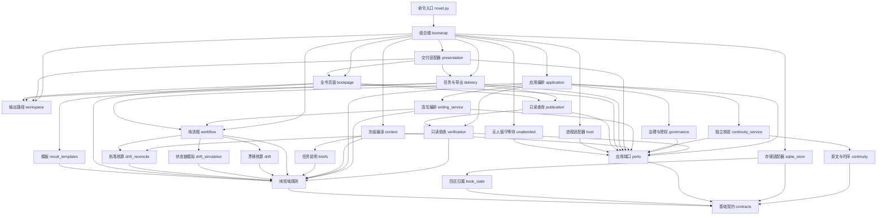

# novel-ledger

长篇小说的写作流程与事实账本：保存作者决定、设计、正文和事实状态，支持连续创作、暂停恢复与历史修订。

运行仅依赖 Python 3.9+ 标准库；模型调用由宿主提供。当前 CLI 版本为 `2.1.2`，数据库为 `novel-ledger/5`，协议边界见 [协议](references/protocol.md#适用范围与字段来源)。

入口：[SKILL.md](SKILL.md) 提供任务路由与执行边界；[运行指南](references/runtime.md) 提供命令动作与恢复方法；[架构](references/architecture.md) 维护模块职责；[返工与成本](references/rework.md) 说明工程原则。

## 一、它解决什么问题

章纲在动笔前声明变化，引擎逐章模拟资源、位置、知情、时钟、人物、情节与伏笔状态。执笔后根据自比回执和正文引文核账，提交成功才更新事实。修订使用候选分支，保留正式稿。

只读验收服务统一核对事实重放、章节链、正文机械项与完本闭合；推进和保存前检查投影属于真实链头，完本重试与导出也重新验证冻结快照。长段模板仅替换数字仍进入返修。章纲生效后固定，正文偏差只返修本章；自动重排不能迁就失败稿，改纲须由作者决定。

可选快速无人值守模式：`run --complete --fast --source 原话`，同一 Worker 按组连写（组大小由 `run --batch N` 配置并随项目保存，缺省取引擎默认 5 章），逐章验收和入库；首章、卷界与作者停点单独处理，见[快速模式](references/runtime.md#快速无人值守分组连写)。

独立连续性核验默认不执行：新CLI项目默认 `continuity=off`，作者明确要求时以 `init --continuity required` 显式开启；开启后先冻结纯正文观察，再读取章纲和执笔自评，报告绑定准确候选与原文。旧项目保持原模式并列出缺少的核验。受控宿主接口能校验身份及真人决定证明，本地CLI仍明确显示未验证的权限边界。两者都不证明文学质量，见[质量与宿主](references/quality.md)。

## 二、架构



图示主要依赖：入口装配适配器，应用通过端口编排，流程与领域规则处理普通值，SQLite 保存事务快照。模块职责、依赖白名单与四区归属统一见 [架构](references/architecture.md)；[图源码](docs/architecture.mmd) 与两处文档图由测试保持一致。

### 五步 → 阶段 → 产物

| 步 | 阶段 | 产物与范围 |
|---|---|---|
| 1 | `opening_options` | 十三门决定，先定脑洞、体量、世界架构与格局，再定视角、主角来历与人物关系（对手网络先于关系落定）；体量门由引擎给板，其余由主干提供选项、作者选择 |
| 2 | `world_model`，默认合并 `opening_contract` | 按档位要求填写世界领域，生成完整约定并核对开书选择 |
| 3 | `volume_outline` | 按约定生成全部卷或进入中的卷，声明剧情、伏笔、文风与卷末终值 |
| 4 | `chapter_outline` | 按卷生成章纲，声明状态增量、进入/退出条件与伏笔动作 |
| 5 | `write` | 正文、自比及核账；机械问题进入 `repair` / `redesign` |

t0/t1 合并卷纲与章纲派工，分别校验。完整阶段集合为上表八个名称；默认长度、策略组合及字段形状见 [叙事推进](references/narrative.md)。

## 三、设计边界

- **单一真源**：SQLite 保存不可变文档和状态投影；正文、证据、事件与状态迁移在同一事务提交。页面和导出可重建。
- **规则共用**：约定字段由 `contracts.CONTRACT_FIELDS` 定义；任务模板、简报与校验从规则表派生。
- **设计先核算**：章纲状态链核验结构化终值与 `clock.to`；`exit_state` 是文字说明。设计被拒时保持原任务重交，不消耗正文返修额度。
- **正文凭证据入账**：自比覆盖计划增量，前态以引擎投影为准。正文必须落实固定章纲，偏差只进入本章返修，见 [漂移核算](references/narrative.md#执笔自比与引擎核算)。
- **额度有限**：每章两次返修、一次重设计；耗尽或连续两轮未解决同一问题时保存候选并等待作者决定。详细规则见 [返工与成本](references/rework.md)。
- **修订保留原稿**：先分析影响，在候选分支修改，通过验收后 `promote` 或用 `discard` 放弃；超出自动范围须对准确方案授权。见 [修订影响分析](references/runtime.md#修订影响分析)。


## 四、项目库与生命周期

写小说产生的项目是**独立目录**，不在本仓库内：

```text
my-novel/
├── novel.sqlite3            唯一真源
├── work/<task_id>/          派工材料与回执（可重建）
├── book.html                固定大小的只读预览入口：看设定 + 按章读正文
├── book.md                  正文导出（完本 deliver，也可 export 预览）
├── delivery.json            完本快照与交付文件的哈希清单
└── world.json              世界模型与选择记录；页面合并到 book.html
```

`book.html` 是**轻量只读预览入口**，不嵌入设定或正文，大小不随书稿增长。init 自动生成；正式 submit 提交后及主干 advance 返回时检查入口，内容未变时不重写；旧的全量页面会替换为轻量入口。预检与事务回滚不改文件，入口失败通过 book_view_error 单独报告，可用 html 重建，不影响已提交正文。

启动预览（仅依赖 Python 标准库）：

```bash
python3 ROOT/scripts/novel.py --project PROJECT preview --open
```

命令选择可用端口、输出本机预览地址并打开浏览器；保持进程运行，结束时按 `Ctrl+C`。可用 `--port 端口` 指定端口，省略 `--open` 只输出地址。双击 `book.html` 会显示该项目的启动命令。服务只监听 `127.0.0.1`，以只读连接直接读取数据库，每个响应使用一致的已提交快照，不提供数据库文件下载或写入接口。设定按栏目请求，目录每页最多 100 章并支持筛选，阅读时只传输当前一章正文；切换栏目、章节或点击“刷新”读取最新已提交内容，无需重新生成页面。完本仍从重新核验后的冻结快照读取。

设定模式保留世界关联图、历史与章节时间线、因果节点图、人物关系、地点站位和进度图表。阅读模式保留字号、版心、纸色和字体设置，`Ctrl+P` 仅打印当前加载的内容。需要可单独携带的完整离线视图时，显式执行 `html --standalone --output book-export.html`；离线导出不能覆盖预览入口 `book.html`。完本 `deliver` 仍交付 `book.md`、轻量 `book.html` 和 `delivery.json`，离线全文可读取 `book.md` 或另行导出。

`export` 输出纯文本或简化 HTML，**默认不会写 `book.html`**（那个位置归全书视图）；需要另一个文件时显式给 `--output`：`export --format md`、`export --output book-plain.html`。

SQLite 中的八张表各司其职：

| 表 | 作用 |
|---|---|
| `kv` | schema 版本、`book` 的四分区哈希目录，以及分支存档、租约等键值 |
| `documents` | 不可变分区（settings/canon/intent/execution）、冻结来源与正文，**按内容哈希寻址** |
| `document_blocks` | 大文档的物理支撑：超过内联阈值的 `documents` 值按内容哈希拆成不可变共享块（见[架构](references/architecture.md)） |
| `tasks` | 冻结输入、回执；**唯一 pending 索引**保证同一时刻只有一个在途任务 |
| `sessions` | 普通会话绑定任务，快速会话绑定连写组；禁止跨组复用 |
| `branches` / `chapters` | 分支与正式章节；每章带正文哈希、事件、章纲、漂移核算结果、状态哈希与**前章链指纹** |
| `journal` | 操作轨迹：派工、提交、取消、改约、修订、完本 |

一次完整生命周期：

```
init ──► 逐门选择（13 门，一门一件事，主干自执）──► 世界模型与完整约定合并起草 ──► 机械校验后激活
   └─ 或 --contract 直接导入完整约定
        │
        ▼
   卷纲提交暂存 ──► 作者 confirm-volume 认可后生效 ──► 章纲（每卷进入前交）
        │                                              │
        │                                     引擎逐章模拟卷内状态链，漂移即拒
        ▼
   执笔（每章）──► drift_check 自比 + 引擎核算 ──► 符合固定章纲才原子入账；偏差保留候选并返修本章正文
        │
        ▼
   卷末按结构化终值与 clock.to 机械闭合 ──► complete 验收（篇幅、required 节点与线路、首章认可）──► deliver
```

t0/t1 的卷纲与章纲可合并交付，但合并结果仍待作者认可；机械通过不能跳过认可门。设计篇幅与范围见 [叙事推进](references/narrative.md#卷纲)。

运行所需路径与常用命令：

```bash
python scripts/novel.py --version          # 以当前输出为准
python scripts/novel.py --help             # 全部子命令
```

先选择一种初始化入口（`$P` 为尚未初始化的独立小说目录）。零输入开书：

```bash
python scripts/novel.py --project "$P" init
python scripts/novel.py --project "$P" advance --compact
```

已有完整约定时，改用以下入口；不在上述项目上再次 init：

```bash
python scripts/novel.py --project "$P" init --contract assets/contract.example.json --source '作者原话'
python scripts/novel.py --project "$P" advance --compact
```

约定生效且作者已授权正文后，保存目标并取得主控租约：

```bash
python scripts/novel.py --project "$P" run --through 3 --source '作者授权先写三章'
```

`run` 返回 `owner` 租约令牌，之后每个主控命令都要带 `--owner <令牌>`，否则返回 `controller_lease`。

连续写作先按 [固定运行版本](references/runtime.md#固定运行版本与受控切换) 建立独立副本；开书自执、世界及后续 Worker 派工、watch 等待与原会话恢复统一见 [主干循环](references/runtime.md#主干循环默认执行路径)。目标尚未交付时继续调度；组完成只结束该 Worker，作者认可和其他决定仍按准确版本登记。

历史正文修订先分析实际影响，再执行候选分支；超界方案绑定准确 plan_hash 等待作者决定。操作与代价见 [修订影响分析](references/runtime.md#修订影响分析)，不在本页维护另一套命令流程。

---

## 五、仓库结构

```text
novel-ledger/
├── README.md             本文件：架构与特点
├── SKILL.md              技能入口（DSH 等宿主的加载说明与执行边界）
├── scripts/
│   ├── novel.py          CLI：参数、访问分级、主控/Worker 边界
│   └── novel_ledger/     模块（contracts 为字段权威；drift 为状态链与漂移核算；style 为文风代理指标；ports 定义层级接口；bootstrap 集中装配）
│       └── templates/   页面 HTML/CSS/JS，导出时内嵌为单文件
├── references/           按任务取用，协议要求与写作建议分开说明
│   ├── opening.md        逐门开书、字段归属与恢复
│   ├── hatch.md          创意方法、换组和转折参考
│   ├── world.md          世界来源、创建、机械校验与下游接口
│   ├── craft.md          规则级别、分阶段写作与执笔自比
│   ├── narrative.md      卷纲、章纲、卷内状态链与漂移核算
│   ├── volume-blueprint.md          卷纲设计蓝图（plot-distill 语料提炼，v1.2 待作者确认；设计层机制已接入，档位空置待确认入库）
│   ├── volume-blueprint-bridge.md   卷纲设计蓝图与引擎字段的对接说明（设计层映射接口）
│   ├── workbench.md      作品理解、稳定场景身份与分级修订
│   ├── editorial.md      人物、场景、补丁、偏离登记与完本
│   ├── runtime.md        主干循环、目标、交接与任务恢复
│   ├── style.md          文风来源、选择、生效与迁移边界
│   ├── styles/           各档特征、例句与集中迁移清单
│   ├── corpus-facts.md   共享语料计数、来源与待复算项
│   ├── quality.md        独立连续性核验与可信宿主
│   ├── rework.md         返工和材料成本原则
│   ├── protocol.md       公共字段、冻结材料、回执与核算
│   ├── architecture.md   模块职责、数据所有权与不变量
│   └── validation.md     工程检查、文学评测及结论依据
├── assets/               可运行的完整约定样例
├── tools/                安装脚本（install-dsh.ps1：链接到 DSH 技能根）
├── docs/                 架构图产物（真源在 references/architecture.md）
├── tests/                协议、流转和版本边界行为测试
└── validation/           活跃验证脚本；archive/ 保存历史记录
```

---

## 五之二、安装到 DeepSeek Harness

DSH 通过 `@deepseek-ai/dsh-skill-filesystem` 发现本地技能（需该 provider 未被禁用）。它按优先级扫描若干根目录，任一根下的 `<name>/SKILL.md` 即为一个技能：

| 优先级 | 根目录 | 说明 |
|---:|---|---|
| 100 | `<projectRoot>/.dsh/skills` | 项目根是最靠近的含 `.git` 的祖先目录；仅对该项目生效 |
| 200 | `<projectRoot>/.agents/skills` | 同上，另一个共享约定 |
| 300 | `customSkillDirs` | 在 DSH 设置里自定义 |
| 400 | `$DSH_HOME/skills`（默认 `~/.dsh/skills`） | **推荐**：开启的每个工作区都能看到 |
| 500 | `$DSH_AGENTS_HOME/skills` | 另一全局根，优先级最低 |

安装就是把仓库链接到某个根目录，让 `git pull` 直接更新已安装的技能：

```powershell
# Windows（无需管理员权限，使用目录 junction）
powershell -ExecutionPolicy Bypass -File tools/install-dsh.ps1
powershell -ExecutionPolicy Bypass -File tools/install-dsh.ps1 -Remove
powershell -ExecutionPolicy Bypass -File tools/install-dsh.ps1 -Root D:\another-skills-root
```

```bash
# POSIX（符号链接）
pwsh tools/install-dsh.ps1            # $DSH_HOME/skills
pwsh tools/install-dsh.ps1 -Remove
```

脚本会在建立链接后自检：SKILL.md 能否透过链接读取、`scripts/novel.py --version` 是否可运行；若目标位置已有真实目录或指向别处的链接，会拒绝而不是覆盖。装好后技能在下次目录刷新时出现，无需重启。

技能正由同一份源码供多个宿主使用（例如 Codex 的 `~/.codex/skills` 也指向本仓库）；每个宿主需要各自建链，改动一次即可全部生效。

---

## 六、开发与验证

```bash
python3 validation/run_tests.py               # 默认快速边界与关键业务链路（120 秒墙钟预算）
python3 validation/run_tests.py e2e           # 重型端到端（整卷连写、CLI 进程交接、冻结安装）
python3 validation/run_tests.py full          # 自动发现全部工程测试（串行）
python -m pytest tests/ -n auto               # 全量并行（需安装 pytest-xdist）
python3 validation/measure.py --out validation/metrics.json          # 依赖图与必读材料度量
```

默认运行快速组，覆盖关键边界与主流程，超墙钟预算即判失败以保持反馈速度；重型端到端（整卷连写、真实 CLI 进程交接、冻结安装）归入 e2e 组；需要完整回归时显式使用 full，自动收集全部工程测试；三组可从其他目录运行，失败返回非零状态。未安装 pytest-xdist 时使用串行入口。页面模板随技能安装，导出为离线单文件。

测试使用合成回执与临时项目：**验证协议、流转、额度与边界，不验证文学质量**。全量项数以本机运行为准（`python3 validation/run_tests.py full`），详细记录见 [历史验收记录](validation/archive/results.md)。历史工程度量见 [2026-10-20 快照修复后测量](validation/archive/quality-metrics-fixed-2026-10-20.json)，内含 UTC 生成时间、源码提交及覆盖本地修改的 Python 源码指纹；历史快照按其原始条件解释。当前度量请运行上面的 `validation/measure.py`，以本次输出的生成时间和源码指纹为准。数百万字的上下文、累计快照与完整来源验收见 [修复报告](validation/archive/storage-snapshot-fix-2026-10-20.md)。改动引擎前请先读 [架构与工程目标](references/architecture.md)，并运行依赖守护测试。

Windows 提示：技能自身按 UTF-8 读写，默认 GBK 控制台下测试与 CLI 均可用；若运行外部校验脚本报编码错误，加 `PYTHONUTF8=1`。

---

## 七、边界与约束

- **字数**按汉字计数；作者约定章数与每章篇幅区间，`word_range` 由二者派生，系统不会为了让指标好看而降低目标。
- **默认字面规则**：正文与标题不出现系统词汇「账本、入账、回执」；**人名禁字默认为空**——起名是作者的决定，需要限制时用 `lexical` 命令按书设定。规则随任务材料的 `policy` 块交付，覆盖范围与版本可查，覆盖内容逐版留档、开书阶段即生效。
- **数据库版本**：`novel-ledger/5`，仅支持当前库，v4 及更早库显式拒绝。
- **文风模式**：默认 `style_guard=observe`，让句段与对白密度随场景自然变化；作者可显式选 `strict` 约束首章数值形状。显式对白目标与高重复仍检查，实际人物声线和视角结合正文判断，见 [创作指导](references/craft.md#人物与表达的真实感)。
- **不做的事**：不自动打开或转换未知来源数据库；不代作者做选择。主干生命周期由宿主提供。
- **未验证的部分**：真实子 agent 的历史隔离、计费用量控制与文学质量；验收方法见 [验证](references/validation.md)。

## 许可

本仓库目前**未附许可证**，默认保留所有权利。如需在其它项目中使用或分发，请先联系作者添加合适许可证（如 MIT）。
