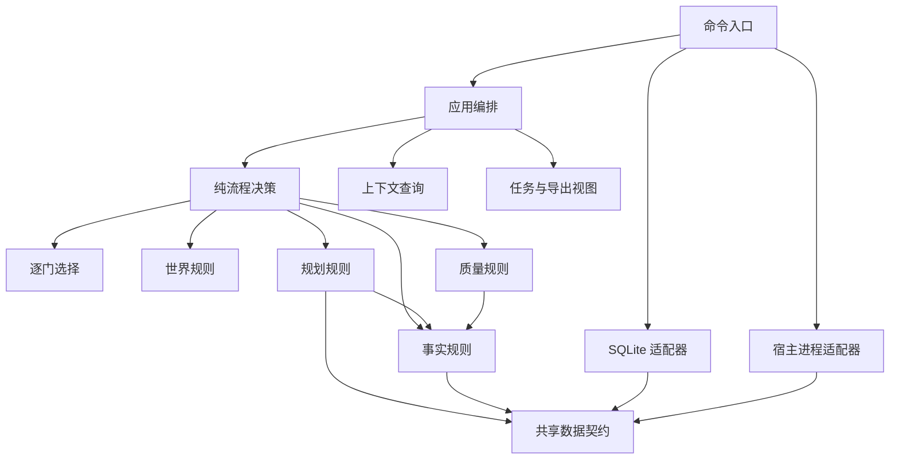

# novel-ledger

长篇小说的**账本式**写作引擎：把作者决定、创作材料、事实状态与审查结论分开记账，用可恢复、可核验的流程支撑几十万到上百万字的连续创作。

仅依赖 Python 3.9+ 标准库，无第三方依赖、无需联网（调用模型的宿主由你自己提供）。

- **定位**：写作流程的**治理层**，不是提示词集合，也不是文本生成器。它不产生一个字，但决定谁能写、写完谁审、事实怎么入账、改稿怎么不毁原稿。
- **形态**：`scripts/novel.py` 一个 CLI + `scripts/novel_ledger/` 13 个模块（多数为纯规则，`sqlite_store`/`delivery`/`host`/`bookpage` 负责 IO）+ 一个 SQLite 项目库。
- **当前版本**：`1.0.0`，数据库 schema `novel-ledger/2`（旧版本库显式拒绝，不做隐式升级）。

---

## 一、它解决什么问题

让模型写长篇，通常在几十章后崩掉：时间线对不上、资源凭空出现、人物知道了他不该知道的事、伏笔丢了、改一章要重写全书。常见做法是往提示词里塞更多规则，但提示词管不住状态——**没人能证明第 47 章的资源余额和第 12 章结算过的一致**。

novel-ledger 把这些问题当**账本问题**处理：让每一章的事实有出处、每一次判断有回执、每一份材料有哈希、每一个额度有上限。核心主张是：

> 文学判断交给独立审稿者，机械可验证的部分交给程序，两者都不许越界。

---

## 二、架构



上图为主要源码依赖；application 逐域 import 与各域到 contracts 的边在图上省略，完整边集由依赖守护测试与 `validation/measure.py` 计数给出（当前 38 条、无环）。渲染图见 [docs/architecture.svg](docs/architecture.svg)；源码真源是 [references/architecture.md](references/architecture.md) 中的 mermaid 块，本图与 `docs/architecture.mmd` 保持逐字一致，由测试守护。

### 分层与职责

| 层 | 模块 | 职责 |
|---|---|---|
| 入口 | `novel.py` | 参数解析、**访问分级**（公开/封印命令）、主控与 Worker 角色边界 |
| 编排 | `application` | 组合领域结果、**单一事务提交**、作者决定、运行认领与租约 |
| 决策（纯） | `workflow` | 下一个任务是什么、状态怎么迁移、修复额度怎么消耗 |
| 选择（纯） | `creation` | 逐门方案、换组回退、闭合选择与来源 |
| 世界（纯） | `world` | 丰富世界记录、跨记录关联、与所选方向的一致性 |
| 规划（纯） | `planning` | 作者约定、设计图、章计划、人物档案校验 |
| 事实（纯） | `facts` | 资源守恒、主支线时钟、知情、关系、地点站位、历史断言的纯结算 |
| 质量（纯） | `quality` | 首读与审稿回执的完整性、一致性、证据核验，模板生成 |
| 查询 | `context` | 冻结来源登记、必读选择、按需补读入口 |
| 视图 | `delivery` | 任务目录物化、模板与表单、正文与世界导出 |
| 全书视图 | `bookpage` | `html` 命令的单文件页面：看设定与读正文两种模式 |
| 持久化 | `sqlite_store` | 事务边界、唯一 pending、幂等回执、不可变文档、分支 |
| 宿主 | `host` | 外部进程执行、超时终止、核实真实提交 |

「纯」= 不 import SQLite、文件、子进程，也不持有全局状态；这条约束由测试里的依赖守护强制（含函数内 import），不是文档口头约定。

---

## 三、六个设计要点

### 1. 单一真源，派生物可弃

SQLite 是唯一持久真源；`work/` 目录、`book.html`、世界视图全部可重建，删掉不影响项目。提交走一个事务入口：领域判断、证据核验、事件结算、状态迁移全部成功才 commit。

新增一条材料或一次判断，只有两个落点——**不可变文档**（按内容哈希存放）或**kv 状态投影**，没有第三处可以偷改。

### 2. 约定形状只有一处定义

`contracts.CONTRACT_FIELDS` 是作者约定形状的唯一权威：交付模板、结构校验、对齐核验全部由它派生。

```python
CONTRACT_FIELDS = (
    {'key': 'title', 'kind': 'text', 'default': '', 'alignment': True},
    ...
    {'key': 'volumes', 'kind': 'rows', 'default': [], 'alignment': True,
     'shape': ('id', 'purpose', 'end'), 'blank': False, 'count': 1},
)
```

结果是三件事同时成立：模板不会漏字段（漏了就等于开书流程走不通）、未知字段直接拒绝（旧版本残留字段无法蒙混）、对齐表与字段表一旦脱节立刻报 `alignment_schema`。派生而非复制，是这套代码里反复出现的做法。

### 3. 事实由独立审稿者从正文重建

执笔任务**只交**正文、标题、摘要与自评；提交 `events` 会被拒绝——事件必须由另一个 Worker 在章审阶段从正文重新读出，逐条附引文与位置，再由程序机械核验前值、守恒、时间推进与引文真实性。执笔自评从不发给审稿者。

程序只证明机械条件（引文存在、数值一致、前值匹配）；**知情、代价与路径是否成立仍由独立审稿者判断**。两类核验（事实 / 阅读）必须都通过，章节才能入库。

### 4. 首读冻结与身份隔离

审稿者先只拿到冻结正文，读完提交「首读」：每章的欲望、阻碍、变化、追读理由。该记录一旦落库即不可改写、不可换人；之后才解锁完整资料做逐项核对。想要换审稿者，只能取消旧任务、生成新首读。

角色边界是**代码执行**的，不是称呼约定：`read`/`recall`/`first-read` 只在携带派工身份（`NOVEL_TASK_ID`）时可用，主控身份调用会被 `role_boundary` 拒绝——「主控不读写正文」由此成立。

### 5. 额度有限，消耗留痕

每章共享一个修复预算：**两次返修 + 一次重设计**。换 Worker、预检回滚、暂停恢复、历史修订、改约都不重置；字段拒绝不计次，但真实的短稿提交计一次并保留稿件。额度耗尽即暂停，保留候选正文与全部失败记录，不无限重试。

首章认可绑定准确的 `prose_hash` 与作者原话；约定变更（`recontract` / `opening`）记录 `producer`，核验者必须不同，且 `promote`、`complete` 的验收会复查这条记录。

### 6. 修订不毁原稿

历史修订从指定章起在**候选分支**完整重写并重审受影响后缀，原正式稿一直保留；范围复核通过才 `promote` 合并，也可以 `discard` 回到原稿与原目标——但已消耗的编辑额度不退还。跨章核验先分块审查全部章节，再由独立综合者阅读块报告、逐章证据与必要原文，独立判断，不能拿块 `pass` 当综合结论。

---

## 四、项目库与生命周期

写小说产生的项目是**独立目录**，不在本仓库内：

```text
my-novel/
├── novel.sqlite3            唯一真源
├── work/<task_id>/          派工材料与回执（可重建）
├── book.html                全书视图：看设定（约定/世界/设计/计划/档案/账本/章审）+ 读正文
├── book.md                  纯文本导出（export）
└── world.html / world.json  世界模型交付
```

`book.html` 是**派生只读视图**：单文件、无外部请求、无服务端，数据全部来自数据库，可随时用 `html` 命令重新生成；删除它不影响项目。阅读模式支持字号、版心、纸色与字体切换，设置存在浏览器本地，`Ctrl+P` 可打印或导出 PDF。

`export` 输出纯文本或简化 HTML，**默认不会写 `book.html`**（那个位置归全书视图）；需要另一个文件时显式给 `--output`：`export --format md`、`export --output book-plain.html`。

SQLite 中的七张表各司其职：

| 表 | 作用 |
|---|---|
| `kv` | schema 版本、治理状态（`book`）、外部键值（分支存档、租约） |
| `documents` | 不可变完整值，**按内容哈希寻址**；冻结来源与正文都在这里 |
| `tasks` | 冻结输入、首读、回执；**唯一 pending 索引**保证同一时刻只有一个在途任务 |
| `sessions` | 会话到任务的绑定，用于**禁止跨任务复用会话** |
| `branches` / `chapters` | 分支与正式章节；每章带正文哈希、事件、计划、审稿、状态哈希与**前章链指纹** |
| `journal` | 操作轨迹：派工、提交、取消、改约、修订、完本 |

一次完整生命周期：

```
init ──► 逐门选择（8 门）──► 世界模型 ＋ 独立核验 ──► 完整约定 ＋ 独立核验
   └─ 或 --contract 直接导入完整约定
        │
        ▼
   全书骨架 ─► 卷布局 ─► 章计划 ─► 人物档案 ─► 执笔 ─► 首读冻结 ─► 章审（事实＋阅读）
        │                                            │
        │                                    入库：结算事实、更新投影、记录链指纹
        ▼
   间隔块审 ─► 卷末审 ─► 全书复核 ─► complete 验收（篇幅、承诺、快照）──► export / html
```

---

## 五、仓库结构

```text
novel-ledger/
├── README.md             本文件：架构与特点
├── SKILL.md              技能入口（DSH 等宿主的加载说明与执行边界）
├── scripts/
│   ├── novel.py          CLI：参数、访问分级、主控/Worker 边界
│   └── novel_ledger/     13 个模块（contracts 为约定字段唯一权威；bookpage 生成全书视图）
├── references/           分任务阅读的规程
│   ├── opening.md        逐门开书
│   ├── world.md          丰富世界模型
│   ├── craft.md          创作与写审
│   ├── runtime.md        运行、恢复、宿主适配
│   ├── protocol.md       任务与结果协议、事件表
│   ├── architecture.md   模块职责、不变量、扩展指引
│   └── validation.md     验证方法与文学评估口径
├── assets/               可运行的完整约定样例
├── docs/                 架构图产物（真源在 references/architecture.md）
├── tests/                80 项行为测试
└── validation/           工程度量脚本与验收记录
```

运行所需路径与常用命令：

```bash
python scripts/novel.py --version          # 1.0.0
python scripts/novel.py --help             # 全部子命令
```

进入真实写作流程需要的最小序列（`$P` 为你的小说目录）：

```bash
python scripts/novel.py --project "$P" init                # 零输入开书
python scripts/novel.py --project "$P" advance             # 取当前门方案或下一个任务
python scripts/novel.py --project "$P" init --contract assets/contract.example.json --source '作者原话'
python scripts/novel.py --project "$P" run --through 3 --source '作者授权先写三章'
```

`run` 返回 `owner` 租约令牌，之后每个主控命令都要带 `--owner <令牌>`，否则返回 `controller_lease`。派工与提交的完整流程见 [运行与恢复](references/runtime.md)。

---

## 六、开发与验证

```bash
PYTHONDONTWRITEBYTECODE=1 python3 -m unittest discover -s tests -v   # 80 项
python3 validation/measure.py --out validation/metrics.json          # 依赖图与必读材料度量
```

测试只用合成回执与临时项目：**验证协议、流转、额度与边界，不验证文学质量**。当前工程度量：13 个核心模块、3,091 行（含 CLI）、38 条内部依赖边、0 个强连通组。改动引擎前请先读 [架构与工程目标](references/architecture.md)，并运行依赖守护测试。

Windows 提示：技能自身按 UTF-8 读写，默认 GBK 控制台下测试与 CLI 均可用；若运行外部校验脚本报编码错误，加 `PYTHONUTF8=1`。

---

## 七、边界与约束

- **字数**按汉字计数；`word_range` 与章幅区间由作者约定，系统不会为了让指标好看而降低目标。
- **默认字面规则**：正文与标题不出现「账本、入账、回执」，人物称呼默认不含「砚」；作者可用 `lexical` 命令覆盖，覆盖内容逐版留档、开书阶段即生效。
- **数据库版本**：`novel-ledger/2`，旧库显式拒绝。
- **不做的事**：不自动打开或转换未知来源数据库；不代作者做选择；不提供后台常驻能力。
- **未验证的部分**（不要把工程夹具当文学成果）：真实模型的历史隔离、应用退出后的持续运行、计费用量控制，以及真实文学质量评估——口径见 [验证](references/validation.md)。

## 许可

本仓库目前**未附许可证**，默认保留所有权利。如需在其它项目中使用或分发，请先联系作者添加合适许可证（如 MIT）。
