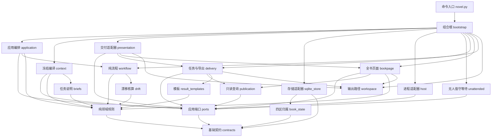

# novel-ledger

长篇小说的**叙事工作台**，以事实账本作为可靠底座：把作者决定、创作材料、事实状态与设计声明分开记账，用可恢复、可核验的流程支撑几十万到上百万字的连续创作。

仅依赖 Python 3.9+ 标准库，无第三方依赖、无需联网（调用模型的宿主由你自己提供）。

- **定位**：写作流程的**治理层**，不是提示词集合，也不是文本生成器。它不产生一个字，但决定谁能写、每章要兑现什么、事实怎么入账、改稿怎么不毁原稿。
- **形态**：`scripts/novel.py` 一个 CLI + `scripts/novel_ledger/` 模块（核心规则与流程处理普通值，具体存储、文件交付和进程在外层装配）+ 一个 SQLite 项目库。
- **当前版本**：`2.0.0`，数据库 schema 仍是 `novel-ledger/3`（已有 v3 可继续使用，v2 及更早库显式拒绝，不做隐式升级）。v2 与 v1 是**流水线换代**：v1 的冻结任务（回执带 `checks_version`/`obligations`、要求首读，或阶段名为 `plan`/`book_plan` 等已删阶段的）在本版本不能执行，需按新协议重新派工；存储结构没有迁移。

**流水线是五步**：十门开书（主干自执）→ 世界模型与约定 → 每卷约 1000 汉字的极简卷纲（含伏笔账与文风走向）→ 含资源/位置/情节漂移字段、伏笔执行与文风声明的极简章纲 → 按章纲执笔并自比，引擎机械核账。**设计层审查与章级独立审已全部删除**（作者决定），判据从"写完之后靠独立审稿者"前移到"章纲声明 + 卷内状态链 + 引擎核算 + 文风代理指标"。

**代价必须说清楚，不粉饰**：不再有独立 agent 复核文学质量与阅读体验。引擎能证明的是"正文与章纲声明一致、文风与锚点一致"——**文风代理指标只保证文风一致、可核对，不证明"这一章好看、人物可信"**。需要真正的文学判断时，只能人工抽读全文，或用离线盲测工具，或另行发起一次修订。详见 [返工与成本](references/rework.md) 第五节。

阅读入口：[SKILL.md](SKILL.md) 面向 agent，提供任务路由、共同边界和最短交接；`references/` 按任务维护专项规则；本 README 面向使用与维护者，说明安装、架构和命令示例。运行状态的完整动作表统一见 [运行与恢复](references/runtime.md#动作分支)。**判据前移的设计与实测见 [返工与成本](references/rework.md)**。

---

## 一、它解决什么问题

让模型写长篇，通常在几十章后崩掉：时间线对不上、资源凭空出现、人物知道了他不该知道的事、伏笔丢了、改一章要重写全书。常见做法是往提示词里塞更多规则，但提示词管不住状态——**没人能证明第 47 章的资源余额和第 12 章结算过的一致**。

novel-ledger 把这些问题当**账本问题**处理：让每一章的事实有出处、每一次判断有回执、每一份材料有哈希、每一个额度有上限。核心主张是：

> 能在设计期机械判定的，就不留到写完之后；判据写进章纲并由引擎逐章模拟核算。机械判定不到的部分（文学质量、阅读体验）不再假装有人复核——它是明确的空白，需要作者自己看。

---

## 二、架构



上图表示层级间的主要源码依赖。`novel.py` 只依赖基础契约与组合根，`bootstrap` 通过 LocalRuntime 统一提供初始化、用例、导出与宿主入口。组合根将具体存储、冻结编译、文件交付、时钟和 ID 生成器接到应用端口，`Application` 只使用注入的能力。图中“纯领域规则”合并展示规则模块（`drift` 单列，因为它是判据前移的主入口）；完整模块依赖由白名单与无环守护检查。渲染图见 [docs/architecture.svg](docs/architecture.svg)（**待重新生成**：本次新增 `drift` 节点与连线，SVG 仍是旧版），真源为 [references/architecture.md](references/architecture.md)；README 和 mmd 快照逐字一致，测试核对“画出的边必须被白名单允许、画出的节点必须解析到真实模块或已声明的聚合组”，但图是摘要，不画出全部允许边。

### 分层与职责

| 层 | 模块 | 职责与边界 |
|---|---|---|
| 入口与装配 | `novel.py`、`bootstrap` | 解析参数、文件与标准输入，执行访问分级及角色边界；组合具体适配器 |
| 基础契约 | `contracts` | 协议、字段、错误和值工具；无应用端口或外部资源 |
| 应用端口 | `ports` | Repository、ContextStore、PublicationReader、TaskCompiler、Presentation、HostApplication；只依赖基础契约 |
| 应用编排 | `application`、`revision_service`、`contract_activation` | Application 保留授权与事务入口；专项服务负责历史修订及约定激活，使用端口与注入能力 |
| 纯流程 | `workflow` | 下一任务、状态迁移与修复额度，按值调用领域规则 |
| 纯领域 | `creation`、`world`、`planning`、`drift`、`style`、`facts` 等 | 逐门选择、世界、卷纲/章纲校验、状态链模拟（含伏笔状态机）、漂移核算、文风代理指标与事实结算；实体、证据和节点查询由独立纯模块共享 |
| 记忆与修订 | `understanding`、`story_memory`、`revision_impact` | 版本解释、场景身份、事实与阅读影响传播；只处理普通值 |
| 数据归属 | `book_state` | 四区字段归属与同一事务快照的拆分、组装 |
| 冻结查询 | `context`、`briefs` | 通过 ContextStore 编译来源与任务说明；不依赖 workflow |
| 发布查询 | `publication` | 通过 PublicationReader 读取正式或冻结交付快照 |
| 本地交付 | `presentation`、`delivery`、`bookpage`、`workspace` | 只读账本，生成任务文件、修复方案、导出与页面；完本清单由应用核验留档；输出位置与保护路径单独注入 |
| 模板 | `result_templates` | 按协议生成回执模板，独立于机械判据模块 |
| 持久化适配器 | `sqlite_store` | SQLite 事务、不可变文档、任务、分支和历史目录；不回收交付文件 |
| 进程适配器 | `host`、`unattended` | 只调用公开应用用例：host 执行外部进程并核实提交，unattended 在引擎进程内等待外部提交并续租（watch）；不读取 app.repo |

独立解耦以**适配器可替换**为标准：替换账本、冻结编译、交付或时钟无需修改应用与纯领域。`tests/test_application_ports.py` 通过内存账本、替代编译器与交付对象完成真实生命周期；`tests/test_presentation_boundaries.py`、`tests/test_host_ports.py` 和 `tests/test_cli_boundary.py` 分别检验只读账本、公开宿主能力与命令运行工厂的替代实现。`tests/test_architecture.py` 扫描所有作用域及绝对包内导入，强制逐模块依赖白名单、核心 I/O 禁令与无环约束。

settings、canon、intent、execution 共同构成**一个作品事务聚合**，共享根快照、提交和版本一致性。四区表达持久化归属，层级端口表达运行依赖边界；跨区规则在同一事务内按普通值协作。

### 五步 → 阶段 → 产物

| 步 | 阶段 | 派工形态 | 产物 |
|---|---|---|---|
| 1 | `opening_options` ×10 门 | 主干自执（不派子 agent） | `opening_choices` / `opening_basis` |
| 2 | `world_model`（payload.also=opening_contract） | 1 次 | 世界 + 约定；提交时机械校验，无审查阶段 |
| 3 | `volume_outline` | 1 次（`scope=all` 时含全部卷；`rolling` 时进卷前 1 次） | 每卷约 1000 汉字的极简卷纲：卷职责/弧线/转折 + **伏笔账 `hooks`**（窗口、required、跨卷）+ **文风走向 `style.trend`** |
| 4 | `chapter_outline` | 每卷 1 次（进入该卷前） | 该卷每章极简章纲：资源/位置/情节/知情/人物/时钟增量 + `enter`/`exit` + **伏笔执行 `hooks`（plant/payoff）** + **文风 `style`** |
| 5 | `write` | 每章 1 次 | 正文 + `drift_check` 自比 + 引擎核算入账（含 hook 事件）+ 文风代理指标；不符 → `repair`/`redesign` 有界返修 |

**钩子与文风的落点**：伏笔在**卷纲声明、章纲执行**——卷纲给出 `plant`/`payoff` 窗口与 `required`/`continues`，章纲只做 `plant` 与 `payoff` 两个动作（中途再提用 `hook_refs`），事件由 `drift.reconcile` 产出，写手不手写事件；文风由**卷纲 `style.trend`（定性走向）+ 章纲 `style`（本章执行）**声明，提交时由 `style.py` 的五条代理指标按契约 `style_window` 容差与首章锚点比对。

t0/t1 由 `PIPELINE_SHAPES.merge_chapter_outline` 把本卷卷纲与章纲合成一次派工，两个契约各自校验同一份回执。完整的阶段集合只有 8 个：`opening_options`、`opening_contract`、`world_model`、`volume_outline`、`chapter_outline`、`write`、`repair`、`redesign`。

### 派工数对比（估算）

以 t2 档 25 章一卷为例，数字按本轮架构规范第 7 节的账估算：

| 流程 | 子 agent 派工 | 构成 |
|---|---:|---|
| 旧（独立写审） | ≈100+ | 2 次世界/约定审、2 次设计审、5 次卷纲 + 5 次卷纲审、约 9 次章计划、25 次章审、若干范围审 |
| 新（五步） | ≈28 | 10 门（主干自执，不计子 agent）+ 1 次世界 + 1 次卷纲 + 1 次章纲 + 25 次执笔 |

省下来的时间与 token 是设计收益；**质量判断的独立性是代价**，两者不能相互替代。

---

## 三、六个设计要点

### 1. 单一真源，派生物可弃

SQLite 是唯一持久真源；`work/` 目录、`book.html`、世界视图全部可重建，删掉不影响项目。提交走一个事务入口：领域判断、证据核验、事件结算、状态迁移全部成功才 commit。

新增一条材料或一次判断，只有两个落点——**不可变文档**（按内容哈希存放）或 **kv 状态投影**，没有第三处可以偷改。

### 2. 约定形状只有一处定义

`contracts.CONTRACT_FIELDS` 是作者约定形状的唯一权威：交付模板、结构校验、对齐核验全部由它派生。

```python
CONTRACT_FIELDS = (
    {'key': 'title', 'kind': 'text', 'default': '', 'alignment': True},
    ...
    {'key': 'volume_outline', 'kind': 'map', 'default': {'scope': 'all', 'words': 1000, 'tolerance': 100}},
    {'key': 'chapter_outline', 'kind': 'map', 'default': {'scope': 'volume', 'words': 150, 'tolerance': 60}},
)
```

结果是三件事同时成立：模板不会漏字段、未知字段直接拒绝（旧版本残留字段无法蒙混）、对齐表与字段表一旦脱节立刻报 `alignment_schema`。派生而非复制，是这套代码里反复出现的做法。

### 3. 章纲就是结算契约

`chapter_outline` 在动笔前声明每一章的资源、位置、知情、时钟、人物与情节增量，外加 `enter`/`exit` 两侧状态；伏笔用 `hooks` 执行（`plant`/`payoff`），文风用 `style` 声明本章执行要求。四个增量数组**可以空、不能省**——空数组等于声明"本章没有这类变化"，它本身就是承诺。

引擎在章纲提交时逐项模拟：资源不能为负、时钟不能倒退、位置必须在世界里、知情不能倒退、人物变化必须给 `choice`/`cost`、node 不能重复推进、thread 关闭后不能重用、伏笔不能重复埋设/重复兑现/越窗/未埋先承接；`exit` 必须等于 `enter ⊕ 本章增量`；卷末必须满足 `exit_state`（容差 0）且本卷 `required` 伏笔全部 `paid`。失败即 `design_drift`，走既有返修预算。

这一步取代了旧的"先写骨架、再脑暴卷方案、再独立设计审、再写章计划、再写人物档案"整条链。

### 4. 执笔自比 + 引擎核算

执笔只交正文、标题、摘要与 `drift_check`：逐项列出本章纲的每个计划增量（含 `kind='hook'` 的埋设/兑现行），`actual.from` 由引擎给出投影值（**不允许写手自报前态**），`kept` 必须与计划一致，`deviated`/`skipped` 必须给理由与正文引文。引擎核算覆盖是否完整、前态是否相符、偏差是否登记，通过后按既有的事实/叙事/空间判据原子入账，并由 `drift.reconcile` 产出伏笔事件。

同一批提交里还会跑**文风代理指标**（`style.py`）：句长、段长、对白占比、本章重复度、视角标记与首章锚点/本章 `style` 的偏差超过契约 `style_window` 就出 style finding，走同一个有界返修。它保证"文风一致、可核对"，**不判断写得好不好看**。

出现偏差时本章照常入库（理由已写明），引擎把偏差记进 `book['design_drift']`，并在下一章前对该卷剩余章纲派一次 `chapter_outline`（带偏差清单）重排——这是删除独立改案阶段后的替代路径。**它保证后续自洽，不会把已写坏的一章变好。**

### 5. 额度有限，消耗留痕

每章共享一个修复预算：**两次返修 + 一次重设计**（`REPAIRS=2`/`REDESIGNS=1`）。换 Worker、预检回滚、暂停恢复、历史修订、改约都不重置；字段拒绝不计次，但真实的短稿提交计一次并保留稿件。额度耗尽或同一条问题连续两轮未解决（`repair-stalled`）即暂停，把"再一轮／接受并记为未解决项／重开或改约"交给作者。

首章认可绑定准确的 `prose_hash` 与作者原话；约定变更（`recontract` / `opening`）记录 `producer`，`promote`、`complete` 的验收会复查作者决定记录。

### 6. 修订不毁原稿

历史修订从指定章起在**候选分支**修改：先做影响分析，受影响的章由 `chapter_outline` 重排（带偏差清单）后重写，其余章按动作重放或原样携带，原正式稿一直保留；机械核算覆盖起章到候选末章后，才 `promote` 合并，也可以 `discard` 回到原稿与原目标——但已消耗的编辑额度不退还。超界方案保存为方案并等待作者对准确 `plan_hash` 的授权。

---

新增编辑能力在当前纯规则层接入：人物成长后重核表达，章纲声明场景意图与展开单元；返修可交版本补丁，但仍重新过全部机械判据。完本从准确快照导出正文、阅读页与清单，失败只恢复交付。字段与边界见 [编辑能力](references/editorial.md)。

新约定默认 `editorial_features=true`；`new_entities` 取代了人物档案派工，新人物首次登场时在章纲内联声明。部分作者要求用 `intake` 保存，只询问未定门；`usage` 与 `scripts/observe.py` 分别观察工程字符和宿主实际 token，`scripts/quality_eval.py` 提供独立盲测样本与定位计分（**v2 流水线里没有独立阅读任务，这是判断文学效果的主要外部手段**）。

## 四、项目库与生命周期

写小说产生的项目是**独立目录**，不在本仓库内：

```text
my-novel/
├── novel.sqlite3            唯一真源
├── work/<task_id>/          派工材料与回执（可重建）
├── book.html                全书视图：看设定（约定/世界/卷纲/章纲/账本/正文）+ 读正文
├── book.md                  正文导出（完本 deliver，也可 export 预览）
├── delivery.json            完本快照与交付文件的哈希清单
└── world.json              世界模型与选择记录；页面合并到 book.html
```

`book.html` 是**派生只读视图**：init 自动生成，开书完成后更新为包含世界设定的统一页面，不再生成单独的 world.html。单文件、无外部请求、无服务端，数据全部来自数据库，可随时用 `html` 命令重新生成；删除它不影响项目。设定模式提供世界关联图、历史与章节时间线、因果节点图、人物关系和地点站位图，以及字数、分卷、章幅与资源图表；图表保留完整文字明细，点击节点可定位详情。阅读模式支持字号、版心、纸色与字体切换，设置存在浏览器本地，`Ctrl+P` 可打印或导出 PDF。

`export` 输出纯文本或简化 HTML，**默认不会写 `book.html`**（那个位置归全书视图）；需要另一个文件时显式给 `--output`：`export --format md`、`export --output book-plain.html`。

SQLite 中的七张表各司其职：

| 表 | 作用 |
|---|---|
| `kv` | schema 版本、`book` 的四分区哈希目录，以及分支存档、租约等键值 |
| `documents` | 不可变分区（settings/canon/intent/execution）、冻结来源与正文，**按内容哈希寻址** |
| `tasks` | 冻结输入、回执；**唯一 pending 索引**保证同一时刻只有一个在途任务 |
| `sessions` | 会话到任务的绑定，用于**禁止跨任务复用会话** |
| `branches` / `chapters` | 分支与正式章节；每章带正文哈希、事件、章纲、漂移核算结果、状态哈希与**前章链指纹** |
| `journal` | 操作轨迹：派工、提交、取消、改约、修订、完本 |

一次完整生命周期：

```
init ──► 逐门选择（10 门，一门一件事，主干自执）──► 世界模型与完整约定合并起草 ──► 机械校验后激活
   └─ 或 --contract 直接导入完整约定
        │
        ▼
   卷纲（每卷约 1000 汉字，默认一次交全部卷）──► 章纲（每卷进入前交，含漂移字段与 enter/exit）
        │                                              │
        │                                     引擎逐章模拟卷内状态链，漂移即拒
        ▼
   执笔（每章）──► drift_check 自比 + 引擎核算 ──► 原子入账；偏差记入 design_drift 并触发下一章纲重排
        │
        ▼
   卷末按 exit_state 机械闭合 ──► complete 验收（篇幅、required 节点与线路、首章认可）──► deliver
```

没有设计审、没有章审、没有范围审：上面每一层的"通过"都来自引擎的机械判定或作者的明确决定。

运行所需路径与常用命令：

```bash
python scripts/novel.py --version          # 2.0.0
python scripts/novel.py --help             # 全部子命令
```

先选择一种初始化入口（`$P` 为尚未初始化的独立小说目录）。零输入开书：

```bash
python scripts/novel.py --project "$P" init
python scripts/novel.py --project "$P" advance --compact
```

已有完整约定时，改用以下入口；不在上述项目上再次 init：

```bash
python scripts/novel.py --project "$P" init --contract assets/contract.example.json --source '作者原话'
python scripts/novel.py --project "$P" advance --compact
```

约定生效且作者已授权正文后，保存目标并取得主控租约：

```bash
python scripts/novel.py --project "$P" run --through 3 --source '作者授权先写三章'
```

`run` 返回 `owner` 租约令牌，之后每个主控命令都要带 `--owner <令牌>`，否则返回 `controller_lease`。

默认主干循环：开书门任务（opening_options）由主干在同一会话自执（无派工收益，免每门一个冷子 agent）；世界模型及之后按 `advance --compact` → 转发任务目录的 `dispatch.md`（Worker 自举卡）派空历史子 agent → `watch --owner ID`（引擎进程内等待提交并续租）→ 取下一派工执行。中文长内容一律走引擎物化的文件工件：任务目录的 `brief.md`（简报全文）与 `dispatch.md`，`await_choice` 时的 `work/board.md`（作者卡片）、`work/question.json`（提问载荷）与 `work/last-advance.json`（完整视图快照，`--compact` 的板面回显压缩为哈希与 option_ids）。主干只处理目标、任务身份、简短状态和治理命令，子 agent 读取完整任务并直接提交；主干生命周期由宿主提供。

章节、卷纲边界与卷末都继续循环；修订就绪按授权 `promote` 后接续，完本依次 `complete`、`deliver`。首章认可和开书选择仍按准确版本保存作者决定。`--compact` 只精简返回主干的派工信息，磁盘 `task.json` 与冻结材料保持完整；`status --tasks` 列出全部派工任务的生命周期视图。完整动作分支见 [运行与恢复](references/runtime.md)；`host-step/host-loop` 保留为可选子进程适配器。

历史修订由作者明确要求发起：先分析实际影响，局部修改后携带无影响原文，语义变化沿依赖传播，受影响的章由章纲重排后重写。自动允许范围之外的请求保存完整方案并返回 `revision_blocked`，等待作者对准确 `plan_hash` 的明确认可。边界由 `editorial.revision_policy` 决定：自动回改限于最近 `limit` 章（`limit = contract.planning_window`，缺省 `REVISION_LIMIT_DEFAULT`），单次重写章数超过 limit 记 `rewrite_limit`，与已写满的整卷相交记 `closed_volume`。详见运行指南。

---

## 五、仓库结构

```text
novel-ledger/
├── README.md             本文件：架构与特点
├── SKILL.md              技能入口（DSH 等宿主的加载说明与执行边界）
├── scripts/
│   ├── novel.py          CLI：参数、访问分级、主控/Worker 边界
│   └── novel_ledger/     模块（contracts 为字段权威；drift 为状态链与漂移核算；style 为文风代理指标；ports 定义层级接口；bootstrap 集中装配）
│       └── templates/   页面 HTML/CSS/JS，导出时内嵌为单文件
├── references/           按任务取用，协议要求与写作建议分开说明
│   ├── opening.md        逐门开书、字段归属与恢复
│   ├── hatch.md          创意方法、换组和转折参考
│   ├── world.md          世界来源、创建、机械校验与下游接口
│   ├── craft.md          规则级别、分阶段写作与执笔自比
│   ├── narrative.md      卷纲、章纲、卷内状态链与漂移核算
│   ├── workbench.md      作品理解、稳定场景身份与分级修订
│   ├── editorial.md      人物、场景、补丁、偏离登记与完本
│   ├── runtime.md        主干循环、目标、交接与任务恢复
│   ├── protocol.md       公共字段、冻结材料、回执与核算
│   ├── architecture.md   模块职责、数据所有权与不变量
│   └── validation.md     工程检查、文学评测及结论依据
├── assets/               可运行的完整约定样例
├── tools/                安装脚本（install-dsh.ps1：链接到 DSH 技能根）
├── docs/                 架构图产物（真源在 references/architecture.md）
├── tests/                协议、流转和版本边界行为测试
└── validation/           工程度量脚本与验收记录
```

---

## 五之二、安装到 DeepSeek Harness

DSH 通过 `@deepseek-ai/dsh-skill-filesystem` 发现本地技能（需该 provider 未被禁用）。它按优先级扫描若干根目录，任一根下的 `<name>/SKILL.md` 即为一个技能：

| 优先级 | 根目录 | 说明 |
|---:|---|---|
| 100 | `<projectRoot>/.dsh/skills` | 项目根是最靠近的含 `.git` 的祖先目录；仅对该项目生效 |
| 200 | `<projectRoot>/.agents/skills` | 同上，另一个共享约定 |
| 300 | `customSkillDirs` | 在 DSH 设置里自定义 |
| 400 | `$DSH_HOME/skills`（默认 `~/.dsh/skills`） | **推荐**：开启的每个工作区都能看到 |

安装就是把仓库链接到某个根目录，让 `git pull` 直接更新已安装的技能：

```powershell
# Windows（无需管理员权限，使用目录 junction）
powershell -ExecutionPolicy Bypass -File tools/install-dsh.ps1
powershell -ExecutionPolicy Bypass -File tools/install-dsh.ps1 -Remove
powershell -ExecutionPolicy Bypass -File tools/install-dsh.ps1 -Root D:\another-skills-root
```

```bash
# POSIX（符号链接）
pwsh tools/install-dsh.ps1            # $DSH_HOME/skills
pwsh tools/install-dsh.ps1 -Remove
```

脚本会在建立链接后自检：SKILL.md 能否透过链接读取、`scripts/novel.py --version` 是否可运行；若目标位置已有真实目录或指向别处的链接，会拒绝而不是覆盖。装好后技能在下次目录刷新时出现，无需重启。

技能正由同一份源码供多个宿主使用（例如 Codex 的 `~/.codex/skills` 也指向本仓库）；每个宿主需要各自建链，改动一次即可全部生效。

---

## 六、开发与验证

```bash
python3 validation/run_tests.py fast          # 快速边界与关键业务链路
python3 validation/run_tests.py full          # 自动发现全部工程测试（串行）
python -m pytest tests/ -n auto               # 全量并行（装 pytest-xdist 后约 1.5 分钟）
python3 validation/measure.py --out validation/metrics.json          # 依赖图与必读材料度量
```

快速组保留关键边界（含档位形状声明、章纲状态链与漂移核算守卫），完整组自动收集新增测试；两种入口均可从其他目录运行，失败返回非零状态，可接入 CI。日常开发循环用 fast 组；改引擎后的全量回归优先 `pytest -n auto`（用例彼此独立：各建临时项目与 SQLite，可安全并行；未装 xdist 时退回串行入口）。最慢的是修订边界/长篇全流程驱动（单条 15～25s），并行下由多核吸收。页面模板位于 `scripts/novel_ledger/templates/`，随技能安装，导出时内嵌为离线单文件。

测试使用合成回执与临时项目：**验证协议、流转、额度与边界，不验证文学质量**。全量项数以本机运行为准（`python3 validation/run_tests.py full`），详细记录见 [验收记录](validation/results.md)。当前工程度量见 [metrics.json](validation/metrics.json)。改动引擎前请先读 [架构与工程目标](references/architecture.md)，并运行依赖守护测试。

Windows 提示：技能自身按 UTF-8 读写，默认 GBK 控制台下测试与 CLI 均可用；若运行外部校验脚本报编码错误，加 `PYTHONUTF8=1`。

---

## 七、边界与约束

- **字数**按汉字计数；`word_range` 与章幅区间由作者约定，系统不会为了让指标好看而降低目标。
- **默认字面规则**：正文与标题不出现系统词汇「账本、入账、回执」；**人名禁字默认为空**——起名是作者的决定，需要限制时用 `lexical` 命令按书设定。规则随任务材料的 `policy` 块交付，覆盖范围与版本可查，覆盖内容逐版留档、开书阶段即生效。
- **数据库版本**：`novel-ledger/3`，已有 v3 可继续使用，v2 及更早库显式拒绝。
- **不做的事**：不自动打开或转换未知来源数据库；不代作者做选择。主干生命周期由宿主提供。
- **未验证的部分**（不要把工程夹具当文学成果）：真实子 agent 的历史隔离、计费用量控制，以及真实文学质量评估——v2 删除了独立审阅者，v2.1 的文风代理指标只覆盖"一致、可核对"这一半，**不构成文学质量证据**；口径见 [验证](references/validation.md)。

## 许可

本仓库目前**未附许可证**，默认保留所有权利。如需在其它项目中使用或分发，请先联系作者添加合适许可证（如 MIT）。

## 叙事推进与长篇材料

新约定默认启用叙事跟踪：卷纲按卷登记主线、支线与暗线及其终局条件，章纲给出每章的节点与线路状态变化，资源/位置/知情/时钟/人物增量由卷内状态链逐章模拟。`narrative_tracking=false` 时节点与线路可空，但四类增量仍必需。完整协议见 [叙事推进](references/narrative.md)。

卷纲默认 `scope=all`：约定生效后一次交全部卷，每卷约 1000 汉字（`tolerance=100`）。`scope=rolling` 改为进入该卷前交该卷；空对象 `{}` 表示关闭卷纲。章纲 `scope=volume`，每章 synopsis 约 150 汉字（`tolerance=60`）。t0/t1 由 `merge_chapter_outline` 把本卷卷纲与章纲合成一次派工。没有正文授权时以 `outline_ready` 交付并停止，范围如实说明（rolling 只交了进入中的那一卷，不能说成全书卷纲）。

卷内状态链取代了原来的分层范围核验：`enter` 与模拟状态必须逐章相等，`exit = enter ⊕ 本章增量`，卷末按 `exit_state` 闭合，本卷 `required` 的伏笔必须全部 `paid`。它挡住的是资源、位置、知情、时钟、人物变化与伏笔埋收的自相矛盾；**因果是否可信、节奏是否成立，v2 没有独立复核者**。

**伏笔账**在卷纲声明（`hooks:[{id,text,plant,payoff,required,continues}]`：`plant` 窗口落在本卷内、`payoff[0] >= plant[1]`、越卷必须 `continues:true` 且 `required:false`），在章纲执行（`hooks:[{hook,action:plant|payoff,note}]`，只有两个动作；同一 id 各一次、payoff 晚于 plant、必须落在窗口内；未埋就 `hook_refs` 承接即漂移）。事件复用既有 hook 事件、由 `drift.reconcile` 从章纲与 `drift_check` 产出，所以 `state.hooks` 对新书不再是空集，`complete()` 的未交代承诺检查是真实检查。

**文风**用"规格 + 机械代理指标"解决可核对的那一半：卷纲 `style.trend` 说本卷怎么走（`window` 与契约 `style_window` 逐项合并），章纲 `style{pov,rhythm,dialogue_ratio,notes}` 说本章怎么执行；引擎按容差与首章锚点比对句长、段长、对白占比、本章重复度与视角标记，越界以 style finding 进入同一个有界返修。**没有锚点时降级**为只查重复度与视角（锚点样本不足 40 汉字同样视为没有锚点）；视角只看引号外的叙述文本，判不出（`unknown`）不算不符；样本过短时按门槛跳过相应判据（正文不足 40 汉字不判，四字窗口 <20 不判重复度，句长/段长只在锚点与本章汉字量 3 倍以内且句数 ≥3 时比较）。这些指标只保证"文风一致、可核对"，**不证明"好看、人物可信"**。

历史来源不再为每轮派工重建全量摘要和事件索引：逐章不可变目录共享未改前缀，任务只冻结目录入口，补读按冻结范围分页返回完整证据及正文。派工资源与承诺摘要取任务冻结视图；原索引名称保持显式完整读取兼容，数据库没有新增表或隐式迁移。

规模与查询读量见 [工程验收](validation/results.md) 的历史来源测量；稀疏检索仍可能遍历全部冻结历史。真实长篇、跨卷文学盲评与实际费用的验收方法见 [验证](references/validation.md)，节奏和多线编排不采用未经验证的固定轮替门槛。

这些是可核验的治理和材料选择机制，不承诺仅靠机械校验证明文学质量或实际模型费用。
