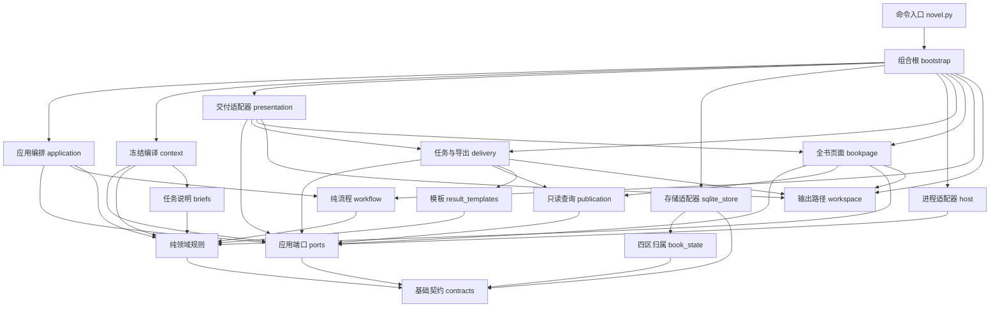

# novel-ledger

长篇小说的**叙事工作台**，以事实账本作为可靠底座：把作者决定、创作材料、事实状态与审查结论分开记账，用可恢复、可核验的流程支撑几十万到上百万字的连续创作。

仅依赖 Python 3.9+ 标准库，无第三方依赖、无需联网（调用模型的宿主由你自己提供）。

- **定位**：写作流程的**治理层**，不是提示词集合，也不是文本生成器。它不产生一个字，但决定谁能写、写完谁审、事实怎么入账、改稿怎么不毁原稿。
- **形态**：`scripts/novel.py` 一个 CLI + `scripts/novel_ledger/` 34 个模块（核心规则与流程处理普通值，具体存储、文件交付和进程在外层装配）+ 一个 SQLite 项目库。
- **当前版本**：`1.5.0`，数据库 schema `novel-ledger/3`（已有 v3 可继续使用，v2 及更早库显式拒绝，不做隐式升级）。

1.5.0 在四分区、滚动规划和独立写审之上加入叙事工作台：作品理解独立于事实与未来方案保存，保留原文表达样本、反证与适用范围；场景身份不绑定章号，支持移动时保留身份；修订区分保留、重读、局部修改和重写。重读通过保留原文，发现实质问题才进入返修及完整独立章审。存储 schema 保持 novel-ledger/3；已有 v3 直接续写保持原能力，可在章节边界显式启用；重新激活的约定按新项目默认启用。新能力不追补旧冻结任务或重解释旧计划；执行层的自动回改范围保护仍适用于旧冻结根审。完整说明见 [叙事工作台](references/workbench.md)。

阅读入口：[SKILL.md](SKILL.md) 面向 agent，提供任务路由、共同边界和最短交接；`references/` 按任务维护专项规则；本 README 面向使用与维护者，说明安装、架构和命令示例。运行状态的完整动作表统一见 [运行与恢复](references/runtime.md#动作分支)。

---

## 一、它解决什么问题

让模型写长篇，通常在几十章后崩掉：时间线对不上、资源凭空出现、人物知道了他不该知道的事、伏笔丢了、改一章要重写全书。常见做法是往提示词里塞更多规则，但提示词管不住状态——**没人能证明第 47 章的资源余额和第 12 章结算过的一致**。

novel-ledger 把这些问题当**账本问题**处理：让每一章的事实有出处、每一次判断有回执、每一份材料有哈希、每一个额度有上限。核心主张是：

> 文学判断交给独立审稿者，机械可验证的部分交给程序，两者都不许越界。

---

## 二、架构



上图表示层级间的主要源码依赖。`novel.py` 只依赖基础契约与组合根，`bootstrap` 通过 LocalRuntime 统一提供初始化、用例、导出与宿主入口。组合根将具体存储、冻结编译、文件交付、时钟和 ID 生成器接到应用端口，`Application` 只使用注入的能力。图中“纯领域规则”合并展示规则模块；完整模块依赖由白名单与无环守护检查。渲染图见 [docs/architecture.svg](docs/architecture.svg)，真源为 [references/architecture.md](references/architecture.md)；README 和 mmd 快照逐字一致，SVG 节点与连线也由测试核对。

### 分层与职责

| 层 | 模块 | 职责与边界 |
|---|---|---|
| 入口与装配 | `novel.py`、`bootstrap` | 解析参数、文件与标准输入，执行访问分级及角色边界；组合具体适配器 |
| 基础契约 | `contracts` | 协议、字段、错误和值工具；无应用端口或外部资源 |
| 应用端口 | `ports` | Repository、ContextStore、PublicationReader、TaskCompiler、Presentation、HostApplication；只依赖基础契约 |
| 应用编排 | `application`、`revision_service`、`contract_activation` | Application 保留授权与事务入口；专项服务负责历史修订及约定激活，使用端口与注入能力 |
| 纯流程 | `workflow` | 下一任务、状态迁移与修复额度，按值调用领域规则 |
| 纯领域 | `creation`、`world`、`planning`、`facts`、`quality` 等 | 逐门选择、世界、规划、事实结算与回执核验；实体、证据和节点查询由独立纯模块共享 |
| 记忆与修订 | `understanding`、`story_memory`、`revision_impact` | 版本解释、场景身份、事实与阅读影响传播；只处理普通值 |
| 数据归属 | `book_state` | 四区字段归属与同一事务快照的拆分、组装 |
| 冻结查询 | `context`、`briefs` | 通过 ContextStore 编译来源与任务说明；不依赖 workflow |
| 发布查询 | `publication` | 通过 PublicationReader 读取正式或冻结交付快照 |
| 本地交付 | `presentation`、`delivery`、`bookpage`、`workspace` | 只读账本，生成任务文件、修复方案、导出与页面；完本清单由应用核验留档；输出位置与保护路径单独注入 |
| 模板 | `result_templates` | 按协议生成回执模板，独立于质量核验模块 |
| 持久化适配器 | `sqlite_store` | SQLite 事务、不可变文档、任务、分支和历史目录；不回收交付文件 |
| 进程适配器 | `host` | 只调用公开应用用例，执行进程、等待与核实提交；不读取 app.repo |

独立解耦以**适配器可替换**为标准：替换账本、冻结编译、交付或时钟无需修改应用与纯领域。`tests/test_application_ports.py` 通过内存账本、替代编译器与交付对象完成真实生命周期；`tests/test_presentation_boundaries.py`、`tests/test_host_ports.py` 和 `tests/test_cli_boundary.py` 分别检验只读账本、公开宿主能力与命令运行工厂的替代实现。`tests/test_architecture.py` 扫描所有作用域及绝对包内导入，强制逐模块依赖白名单、核心 I/O 禁令与无环约束。

settings、canon、intent、execution 共同构成**一个作品事务聚合**，共享根快照、提交和版本一致性。四区表达持久化归属，层级端口表达运行依赖边界；跨区规则在同一事务内按普通值协作。

---

## 三、六个设计要点

### 1. 单一真源，派生物可弃

SQLite 是唯一持久真源；`work/` 目录、`book.html`、世界视图全部可重建，删掉不影响项目。提交走一个事务入口：领域判断、证据核验、事件结算、状态迁移全部成功才 commit。

新增一条材料或一次判断，只有两个落点——**不可变文档**（按内容哈希存放）或**kv 状态投影**，没有第三处可以偷改。

### 2. 约定形状只有一处定义

`contracts.CONTRACT_FIELDS` 是作者约定形状的唯一权威：交付模板、结构校验、对齐核验全部由它派生。

```python
CONTRACT_FIELDS = (
    {'key': 'title', 'kind': 'text', 'default': '', 'alignment': True},
    ...
    {'key': 'volumes', 'kind': 'rows', 'default': [], 'alignment': True,
     'shape': ('id', 'purpose', 'end'), 'blank': False, 'count': 1},
)
```

结果是三件事同时成立：模板不会漏字段（漏了就等于开书流程走不通）、未知字段直接拒绝（旧版本残留字段无法蒙混）、对齐表与字段表一旦脱节立刻报 `alignment_schema`。派生而非复制，是这套代码里反复出现的做法。

### 3. 事实由独立审稿者从正文重建

执笔任务**只交**正文、标题、摘要与自评；提交 `events` 会被拒绝——事件必须由另一个 Worker 在章审阶段从正文重新读出，逐条附引文与位置，再由程序机械核验前值、守恒、时间推进与引文真实性。执笔自评从不发给审稿者。

程序只证明机械条件（引文存在、数值一致、前值匹配）；**知情、代价与路径是否成立仍由独立审稿者判断**。两类核验（事实 / 阅读）必须都通过，章节才能入库。

### 4. 首读冻结与身份隔离

审稿者先只拿到冻结正文，读完提交「首读」：每章的欲望、阻碍、变化、追读理由。该记录一旦落库即不可改写、不可换人；之后才解锁完整资料做逐项核对。想要换审稿者，只能取消旧任务、生成新首读。

角色边界是**代码执行**的，不是称呼约定：`read`/`recall`/`first-read` 只在携带派工身份（`NOVEL_TASK_ID`）时可用，主控身份调用会被 `role_boundary` 拒绝——「主控不读写正文」由此成立。

### 5. 额度有限，消耗留痕

每章共享一个修复预算：**两次返修 + 一次重设计**。换 Worker、预检回滚、暂停恢复、历史修订、改约都不重置；字段拒绝不计次，但真实的短稿提交计一次并保留稿件。额度耗尽即暂停，保留候选正文与全部失败记录，不无限重试。

首章认可绑定准确的 `prose_hash` 与作者原话；约定变更（`recontract` / `opening`）记录 `producer`，核验者必须不同，且 `promote`、`complete` 的验收会复查这条记录。

### 6. 修订不毁原稿

历史修订从指定章起在**候选分支**修改，实际修改章完成完整独立章审，后文按事实与阅读影响重读或携带，原正式稿一直保留；范围复核通过才 `promote` 合并，也可以 `discard` 回到原稿与原目标——但已消耗的编辑额度不退还。跨章核验先分块审查全部章节，再由独立综合者阅读块报告、逐章证据与必要原文，独立判断，不能拿块 `pass` 当综合结论。

---

新增编辑能力在当前纯规则层接入：人物成长后重核表达，章计划声明场景意图与展开单元；返修可交版本补丁，但仍完整独立重审。成立正文的偏离可独立改案，卷末按职责关闭、补写或修订，根问题两轮额度跨任务与分支保留。完本从准确快照导出正文、阅读页与清单，失败只恢复交付。字段与边界见 [编辑能力](references/editorial.md)。

新约定默认 `editorial_features=true`，任务冻结 `editorial/1` 与检查清单 3（约定声明了 `pov` 时用清单 4，多一项 `reader.pov_consistency`）；检查清单随当前库的任务冻结，已保存回执按自己的版本复核。部分作者要求用 `intake` 保存，只询问未定门；`usage` 与 `scripts/observe.py` 分别观察工程字符和宿主实际 token，`scripts/quality_eval.py` 提供独立盲测样本、首读冻结与定位计分。

## 四、项目库与生命周期

写小说产生的项目是**独立目录**，不在本仓库内：

```text
my-novel/
├── novel.sqlite3            唯一真源
├── work/<task_id>/          派工材料与回执（可重建）
├── book.html                全书视图：看设定（约定/世界/设计/计划/档案/账本/章审）+ 读正文
├── book.md                  正文导出（完本 deliver，也可 export 预览）
├── delivery.json            完本快照与交付文件的哈希清单
└── world.json              世界模型与选择、核验记录；页面合并到 book.html
```

`book.html` 是**派生只读视图**：init 自动生成，开书完成后更新为包含世界设定的统一页面，不再生成单独的 world.html。单文件、无外部请求、无服务端，数据全部来自数据库，可随时用 `html` 命令重新生成；删除它不影响项目。设定模式提供世界关联图、历史与章节时间线、因果节点图、人物关系和地点站位图，以及字数、分卷、章幅与资源图表；图表保留完整文字明细，点击节点可定位详情。阅读模式支持字号、版心、纸色与字体切换，设置存在浏览器本地，`Ctrl+P` 可打印或导出 PDF。

`export` 输出纯文本或简化 HTML，**默认不会写 `book.html`**（那个位置归全书视图）；需要另一个文件时显式给 `--output`：`export --format md`、`export --output book-plain.html`。

SQLite 中的七张表各司其职：

| 表 | 作用 |
|---|---|
| `kv` | schema 版本、`book` 的四分区哈希目录，以及分支存档、租约等键值 |
| `documents` | 不可变分区（settings/canon/intent/execution）、冻结来源与正文，**按内容哈希寻址** |
| `tasks` | 冻结输入、首读、回执；**唯一 pending 索引**保证同一时刻只有一个在途任务 |
| `sessions` | 会话到任务的绑定，用于**禁止跨任务复用会话** |
| `branches` / `chapters` | 分支与正式章节；每章带正文哈希、事件、计划、审稿、状态哈希与**前章链指纹** |
| `journal` | 操作轨迹：派工、提交、取消、改约、修订、完本 |

一次完整生命周期：

```
init ──► 逐门选择（10 门，一门一件事）──► 世界模型与完整约定合并起草 ──► 独立世界核验 ──► 独立约定核验
   └─ 或 --contract 直接导入完整约定
        │
        ▼
   全书骨架 ─► 卷内脑暴 ─► 近期卷纲（按需续批、独立核验） ─► 章计划 ─► 人物档案 ─► 执笔 ─► 首读冻结 ─► 章审（事实＋阅读）
        │                                            │
        │                                    入库：结算事实、更新投影、记录链指纹
        ▼
   间隔块审 ─► 卷末审 ─► 全书复核 ─► complete 验收（篇幅、承诺、快照）──► deliver（正文、阅读页、清单）
```

---

## 五、仓库结构

```text
novel-ledger/
├── README.md             本文件：架构与特点
├── SKILL.md              技能入口（DSH 等宿主的加载说明与执行边界）
├── scripts/
│   ├── novel.py          CLI：参数、访问分级、主控/Worker 边界
│   └── novel_ledger/     34 个模块（contracts 为字段权威；ports 定义层级接口；bootstrap 集中装配）
│       └── templates/   页面 HTML/CSS/JS，导出时内嵌为单文件
├── references/           按任务取用，协议要求与写作建议分开说明
│   ├── opening.md        逐门开书、字段归属与恢复
│   ├── hatch.md          创意方法、换组和转折参考
│   ├── world.md          世界来源、创建、核验与交付
│   ├── craft.md          规则级别、分阶段写作与审稿依据
│   ├── narrative.md      滚动卷纲、叙事依赖与分层核验
│   ├── workbench.md      作品理解、稳定场景身份与分级修订
│   ├── editorial.md      人物、场景、补丁、改案与关闭
│   ├── runtime.md        主干循环、目标、交接与任务恢复
│   ├── protocol.md       公共字段、冻结材料、回执与事件
│   ├── architecture.md   模块职责、数据所有权与不变量
│   └── validation.md     工程检查、文学评估及结论依据
├── assets/               可运行的完整约定样例
├── tools/                安装脚本（install-dsh.ps1：链接到 DSH 技能根）
├── docs/                 架构图产物（真源在 references/architecture.md）
├── tests/                协议、流转和版本边界行为测试
└── validation/           工程度量脚本与验收记录
```

运行所需路径与常用命令：

```bash
python scripts/novel.py --version          # 1.5.0
python scripts/novel.py --help             # 全部子命令
```

先选择一种初始化入口（`$P` 为尚未初始化的独立小说目录）。零输入开书：

```bash
python scripts/novel.py --project "$P" init
python scripts/novel.py --project "$P" advance --compact
```

已有完整约定时，改用以下入口；不在上述项目上再次 init：

```bash
python scripts/novel.py --project "$P" init --contract assets/contract.example.json --source '作者原话'
python scripts/novel.py --project "$P" advance --compact
```

约定生效且作者已授权正文后，保存目标并取得主控租约：

```bash
python scripts/novel.py --project "$P" run --through 3 --source '作者授权先写三章'
```

`run` 返回 `owner` 租约令牌，之后每个主控命令都要带 `--owner <令牌>`，否则返回 `controller_lease`。

默认由主干循环调度子 agent：`advance --compact` → 按 `task_path` 派空历史子 agent → 等待结束 → `advance --compact --after 任务ID` 核实提交并接续。主干只处理目标、任务身份、简短状态和治理命令，子 agent 读取完整任务并直接提交；主干生命周期由宿主提供。

章节、规划窗口和卷末都继续循环；修订就绪按授权 `promote` 后接续，完本依次 `complete`、`deliver`。首章认可和开书选择仍按准确版本保存作者决定。`--compact` 只精简返回主干的派工信息，磁盘 `task.json` 与冻结材料保持完整；`review_session` 指明原审稿会话，执行中的子 agent 不重复派工。完整动作分支见 [运行与恢复](references/runtime.md)；`host-step/host-loop` 保留为可选子进程适配器。

审稿触发的历史修订先分析实际影响：局部修改后保留无影响原文，阅读变化先独立重读，语义变化沿依赖传播。自动回改限于最近 `planning_window` 个已写章（默认 3 章），并保护已关闭卷的验收范围；超界返回 `revision_blocked`，保存完整修复方案而不启动重写。扩大执行需作者明确认可准确 `plan_hash`，详见运行指南。

---

## 五之二、安装到 DeepSeek Harness

DSH 通过 `@deepseek-ai/dsh-skill-filesystem` 发现本地技能（需该 provider 未被禁用）。它按优先级扫描若干根目录，任一根下的 `<name>/SKILL.md` 即为一个技能：

| 优先级 | 根目录 | 说明 |
|---:|---|---|
| 100 | `<projectRoot>/.dsh/skills` | 项目根是最靠近的含 `.git` 的祖先目录；仅对该项目生效 |
| 200 | `<projectRoot>/.agents/skills` | 同上，另一个共享约定 |
| 300 | `customSkillDirs` | 在 DSH 设置里自定义 |
| 400 | `$DSH_HOME/skills`（默认 `~/.dsh/skills`） | **推荐**：开启的每个工作区都能看到 |

安装就是把仓库链接到某个根目录，让 `git pull` 直接更新已安装的技能：

```powershell
# Windows（无需管理员权限，使用目录 junction）
powershell -ExecutionPolicy Bypass -File tools/install-dsh.ps1
powershell -ExecutionPolicy Bypass -File tools/install-dsh.ps1 -Remove
powershell -ExecutionPolicy Bypass -File tools/install-dsh.ps1 -Root D:\another-skills-root
```

```bash
# POSIX（符号链接）
pwsh tools/install-dsh.ps1            # $DSH_HOME/skills
pwsh tools/install-dsh.ps1 -Remove
```

脚本会在建立链接后自检：SKILL.md 能否透过链接读取、`scripts/novel.py --version` 是否可运行；若目标位置已有真实目录或指向别处的链接，会拒绝而不是覆盖。装好后技能在下次目录刷新时出现，无需重启。

技能正由同一份源码供多个宿主使用（例如 Codex 的 `~/.codex/skills` 也指向本仓库）；每个宿主需要各自建链，改动一次即可全部生效。

---

## 六、开发与验证

```bash
python3 validation/run_tests.py fast          # 快速边界与关键业务链路
python3 validation/run_tests.py full          # 自动发现全部工程测试
python3 validation/measure.py --out validation/metrics.json          # 依赖图与必读材料度量
```

快速组保留关键边界，完整组自动收集新增测试；两种入口均可从其他目录运行，失败返回非零状态，可接入 CI。页面模板位于 `scripts/novel_ledger/templates/`，随技能安装，导出时内嵌为离线单文件。

测试使用合成回执与临时项目：**验证协议、流转、额度与边界，不验证文学质量**。当前全量 372 项工程测试通过，详细记录见 [验收记录](validation/results.md)。当前工程度量见 [metrics.json](validation/metrics.json)，包含所有函数内导入；纯规则依赖仍无环。改动引擎前请先读 [架构与工程目标](references/architecture.md)，并运行依赖守护测试。

Windows 提示：技能自身按 UTF-8 读写，默认 GBK 控制台下测试与 CLI 均可用；若运行外部校验脚本报编码错误，加 `PYTHONUTF8=1`。

---

## 七、边界与约束

- **字数**按汉字计数；`word_range` 与章幅区间由作者约定，系统不会为了让指标好看而降低目标。
- **默认字面规则**：正文与标题不出现系统词汇「账本、入账、回执」；**人名禁字默认为空**——起名是作者的决定，需要限制时用 `lexical` 命令按书设定。规则随任务材料的 `policy` 块交付，覆盖范围与版本可查，覆盖内容逐版留档、开书阶段即生效。
- **数据库版本**：`novel-ledger/3`，已有 v3 可继续使用，v2 及更早库显式拒绝。
- **不做的事**：不自动打开或转换未知来源数据库；不代作者做选择。主干生命周期由宿主提供。
- **未验证的部分**（不要把工程夹具当文学成果）：真实子 agent 的历史隔离、计费用量控制，以及真实文学质量评估——口径见 [验证](references/validation.md)。

## 许可

本仓库目前**未附许可证**，默认保留所有权利。如需在其它项目中使用或分发，请先联系作者添加合适许可证（如 MIT）。

## 叙事推进与长篇材料

新约定默认启用叙事跟踪：主线、支线与暗线登记职责和终局条件；节点推进、读者已见信息、人物当前动机和节奏均由独立审稿举证后结算。窗口前提变化触发重规划，每章根据真实累计篇幅计算剩余预算。完整协议见 [叙事推进](references/narrative.md)。

世界模型核验后，新约定默认 scope=rolling：先建立全书关键骨架和首卷方向，再设计、独立核验近期卷纲，每批最多 min(6,planning_window) 章，每章目标 500 汉字（450～550）。进入未覆盖章节时才补下一批，远期卷保留职责与关键节点；没有正文授权以 outline_ready 的 planning_mode/coverage 如实交付近期范围。scope=all 可在正文前完成全部卷纲，scope=current 则逐卷完整设计，tolerance=0 可要求严格 500 字。

范围核验先完整读叶块，再按有限扇出逐层综合子报告与边界原文；正文、原报告与完整设计仍保留补读入口。执笔只取目标和直接因果前置，历史可按人物、节点、主题或线路检索。当前库的任务及回执保留冻结的能力和检查版本，已有审稿不因新增清单追溯失效；v2 及更早数据库不在本版本的打开范围内。

历史来源不再为每轮派工重建全量摘要和事件索引：逐章不可变目录共享未改前缀，任务只冻结目录入口，补读按冻结范围分页返回完整证据及正文。远期承诺可由独立审稿按证据登记人物/物品和话题关联，相关对象再次登场即可带入任务材料；未标注旧承诺仍可补读。派工资源与承诺摘要也取任务冻结视图。原索引名称保持显式完整读取兼容，数据库没有新增表或隐式迁移。

规模与查询读量见 [工程验收](validation/results.md) 的历史来源测量；稀疏检索仍可能遍历全部冻结历史。真实长篇、跨卷文学盲评与实际费用的验收方法见 [验证](references/validation.md)，节奏和多线编排不采用未经验证的固定轮替门槛。

这些是可核验的治理和材料选择机制，不承诺仅靠机械校验证明文学质量或实际模型费用。
