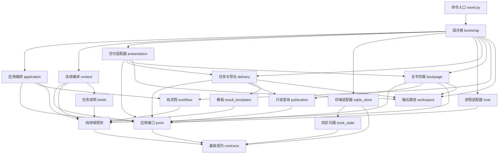

# 架构与工程目标

何时读：修改引擎、扩展命令或判断能力边界。

工程目标：百万字长篇的开书、稳定全书骨架、卷布局、近期细化、逐章独立写审、历史修订、断点恢复与最终交付。协议和代码为独立实现，不与其他小说工程互通数据库或命令行为。

## 适用范围与维护依据

本页规定工程依赖、数据所有权和提交不变量。作者的创作决定保存在约定与原话中，写审判断见 [创作与写审](craft.md)；不把架构选择转换为正文写法要求。

字段与校验以源码声明和任务模板为准，接口摘要见 [协议](protocol.md)；命令及恢复步骤见 [运行](runtime.md)；测试、度量和真实长篇验收口径见 [验证](validation.md)。本文的 Mermaid 块是架构图真源，docs 为派生产物，生成及核对方法见 [图表维护](../docs/README.md)。

| 工程问题 | 读取位置 |
|---|---|
| 模块依赖、端口替换与装配 | [依赖方向](#依赖方向) |
| 主干、Worker、作者与事实的职责 | [主干循环与子 agent](#主干循环与子-agent)、[数据所有权与角色](#数据所有权与角色) |
| 修改提交、分区、缓存或恢复 | [不变量](#不变量)、[数据与失败](#数据与失败) |
| 判断已有能力与尚未支持的行为 | [当前能力边界](#当前能力边界)、[叙事与材料边界](#叙事与材料边界) |

## 叙事工作台与可靠底座

作者约定提供作品方向；滚动规划和场景创作使用有版本的创作记忆；独立读者的解释写入 understanding，实际事件才写入 canon。context 将方向、当前事实、相关理解与原文编译为冻结任务，workflow 仍负责交接，SQLite 事务、不可变文档和章节分支作为可靠底座。工作台不要求长期复用一个模型会话，创作理解通过可核对的记录延续。

understanding 是 intent 内独立的版本对象，不把解释与未来方案混成事实；原文证据失效时撤下对应版本，未改后文携带后恢复其有效记录。稳定场景身份与阅读位置分离，故事时间和披露另行记录。revision_impact 同时给出事实重写范围和阅读重检动作；revision_review 通过即保留原文，失败才进入 local/chapter 返修与完整章审。协议和已有项目显式启用见 [叙事工作台](workbench.md)。

## 主干循环与子 agent

宿主主干管理作者目标、任务身份、治理命令与简短进度；独立 Worker 读取完整冻结材料，完成当前规划、执笔或审稿并提交。workflow 决定下一任务，主干只接收身份及状态摘要，正文与完整回执保留在项目中。主干生命周期和模型会话隔离由宿主提供，host 是可选的外部进程适配器。

compact 是派工返回视图，冻结任务、正文和首读材料保持完整。任务身份、执行认领与真实审稿会话分别承担提交校验、并发占用和首读连续性，不能相互替代。派工、等待、同会话恢复及提交核实统一见 [主干循环](runtime.md#主干循环默认执行路径) 与 [任务交接](runtime.md#任务交接)；修订采纳、完本和交付统一按 [动作分支](runtime.md#动作分支) 执行。

## 依赖方向

箭头表示主要源码依赖，方向从调用方指向依赖。`novel.py` 只依赖基础契约与组合根，`bootstrap` 的 LocalRuntime 统一打开/初始化账本并提供视图、导出、交付与宿主执行入口。`bootstrap` 装配 SQLite、冻结编译器、文件交付、时钟与 ID 生成器；`Application` 只接收 `ports` 中声明的能力，通过注入的接口完成持久化、任务编译与交付。核心不发现项目目录、数据库文件、标准输入或宿主进程。`host` 只调用公开用例与任务状态查询。`TaskDelivery` 可选携带 `process: FileTaskTransport`，其中声明实际项目、任务和日志路径；子进程宿主在 claim 前验证该文件传输能力，非文件交付按 `host_transport` 拒绝且不会留下执行租约。

层级独立以可替换性为标准：存储、冻结编译、交付、时间和身份提供方可各自替换，核心规则与用例无需修改。`context` 依赖最小 `ContextStore`，交付与全书视图依赖只读 `PublicationReader`，完本交付也只生成文件与清单；组合根将清单交给应用的 `record_delivery` 核对当前完本快照并事务留档；查询辅助、实体注册和证据校验有独立纯模块，避免从较高层借用私有方法。模板生成由 `result_templates` 负责，`quality` 只核验回执。

图中应用编排包含 `application`、`revision_service` 与 `contract_activation`。Application 保留公开用例、授权检查与事务入口；修订服务负责影响分析、分支建立、后缀重放与理解恢复，约定激活服务负责已核验约定切换。两者在调用方事务内使用 Repository 端口；修订服务只额外接收明确的任务取消能力，不依赖 Application 或自行提交事务。

图中“纯领域规则”汇总规则模块，略去逐域边以保持可读。完整依赖白名单、所有作用域的导入、核心 I/O 禁令和无环约束由 `tests/test_architecture.py` 强制。替换验证须通过实际用例观察结果：内存账本跑通生命周期、只读账本生成交付、替代宿主与运行工厂执行公开入口，真实组合根另验收事务与文件效果衔接。具体回归入口按 [改动类型选择验证](validation.md#按改动类型选择验证)，完整边集由 `validation/measure.py` 测量。

架构图存放于 [docs/architecture.svg](../docs/architecture.svg)。图表与字段的说明各自引用对应真源，不在派生文件或其他文档中另立一套结构要求。

| 文件 | 权威职责 |
|---|---|
| contracts | 协议标识、约定字段表与按版本过滤的对齐字段、结构门档位表、检查点与检查清单版本、修复上限、发现严重度与作者通道阶段表、错误形状；约定形状与阶段权限的唯一权威 |
| ports | 持久化、只读查询、冻结编译、交付与宿主用例的能力契约；只依赖 contracts，不持有具体资源 |
| creation | 零输入方案、逐门选择、换组回退、闭合选择与来源；门序按协议版本冻结（creation/1 八门、creation/2 十门、creation/3 十门男频方向），结构门的档位板由引擎按档位表即时给出；对齐字段由字段表派生 |
| world | 丰富世界记录、关联及选择一致性，保持设计与事实分离 |
| planning | 作者约定、设计图、章计划和人物档案校验 |
| narrative | 线路、节点、读者认知、人物当前状态、节奏与动态篇幅的纯规则 |
| scopes | 有界覆盖树、报告复用与交接摘要规则 |
| entities / evidence / design_queries | 实体注册、原文证据与设计节点查询的纯共享规则，领域模块直接复用 |
| craft | 人物解释与成长签名、场景意图与展开、版本补丁合成；只依赖 contracts |
| spatial | 稳定锚点、路径与视听连接、持有链和到达下限；只依赖 contracts |
| editorial | 正文实现裁决、根修复案例、卷末职责、关闭验收范围、自动回改策略与终审覆盖；只依赖 contracts |
| facts | 原文定位、事件前值、资源、时钟、站位与历史断言的纯结算 |
| quality | 首读与独立审稿回执的完整性、一致性、证据核验；作者级发现的形状与“写作端可修”的区分 |
| workflow | 下一任务和状态转换，内容与篇幅共享修复额度 |
| briefs / result_templates | 按阶段生成任务说明与交付模板；不承担回执核验 |
| context | 面向 ContextStore 编译冻结来源、必读选择和按需资料，不依赖 workflow |
| publication | 面向 PublicationReader 的只读交付快照查询 |
| application | 公开用例、作者与运行授权、准确方案授权和单一事务入口；组合领域及专项应用服务，不解析输入文件或生成交付文件 |
| revision_service / contract_activation | 同事务内的历史修订、后缀重放、理解恢复及已核验约定激活；依赖端口与纯规则，不反向调用应用用例 |
| sqlite_store | 持久化、唯一 pending、幂等回执、不可变材料及分支；逐章历史来源与增量目录缓存；未达文档回收 |
| presentation | 实现交付端口，组合任务目录、修复方案、世界及全书视图 |
| workspace | 输出位置与受保护资源别名判定；保护路径由存储适配器经组合根注入 |
| delivery | 任务目录物化、表单保留与回收、正文和世界导出 |
| bookpage | 统一 book.html 的只读数据准备、转义与渲染；templates/ 保存 HTML 外壳及 CSS/JS，导出时全部内嵌 |
| host | 面向 HostApplication 的外部进程执行、超时终止和实际提交核实，不访问应用内部 Repository |
| book_state | 项目分区的字段所有权与事务内组装；只依赖 contracts |
| story_memory | 不绑定章号的场景身份、事实/阅读关联及带来源的场景材料；旧任务按冻结身份协议；只依赖 contracts |
| revision_impact | 根据已提交计划、事件与版本指纹保守传播事实和阅读影响，输出 keep/review/local/rewrite；只依赖 contracts/story_memory |
| understanding | 可修订解释、原文与反证、版本选择、适用范围及随正文版本失效/恢复；只依赖 contracts |
| bootstrap | 唯一的本地组合根，将具体存储、查询、交付、时钟和 ID 提供方接到应用端口 |
| novel.py | 参数、文件/标准输入解析、访问分级与 Worker 边界；只依赖 contracts 与 bootstrap，经可替换运行工厂调用公开能力 |

## 数据所有权与角色

### 作者决定与开书结构

- 约定形状只有一处定义：contracts.CONTRACT_FIELDS（字段、类型、占位、可选性、是否参与对齐、自哪个开书版本起生效）。交付模板（result_templates.template → contracts.contract_skeleton）、结构校验（planning.validate_contract → contracts.contract_errors）和对齐核验（creation.validate_contract）全部由它派生；新增约定字段只改这张表，对齐表与字段表不一致时报 alignment_schema。对齐字段按开书版本过滤（contracts.alignment_for）：后来新增的字段不会变成旧约定没做过、却被追溯追责的决定。
- 十门开书中，直接选择字段的唯一来源也声明在 CONTRACT_FIELDS.opening：`(门 ID, value 字段)`，主角整份选择通过字段的 shape 声明。creation 从同一声明派生各门允许的输入字段和约定对齐值；世界与体量的推导输入单列在 creation.DERIVATION_INPUTS。方案提交、intake 和闭合选择的约定核验均拒绝跨门及未知字段，错误带 allowed_fields/unknown_fields。对齐值逐字段读取，禁止整份 value 合并覆盖其他门的决定。
- 开书协议版本随项目文档冻结：creation 状态的 `schema`（novel-ledger.creation/N）决定门序、value 规则与对齐范围，方案篇幅上界由新任务的 opening-bounds/1 能力冻结，不重验旧已接受方案板。存储 schema 为 novel-ledger/3，因项目真源改为不可变分区而升级；已有 v3 可继续使用，v2 及更早库明确拒绝，不提供隐式迁移。
- 作者可见的方案板有两类来源：创意门的板子由新空历史 Worker 生成；结构门（体量与分卷）的档位板由引擎按 contracts.SCALE_TIERS 当次给出，不派工、不等待，Worker 回执按 opening_system 拒绝。引擎只给经证明写得完的档位，选择仍由作者做出，程序不替作者决定。
- 体量窗口只决定展示哪些档位；相邻档位与最大档由完整 SCALE_TIERS 决定。同一档位在不同窗口的说明与数值一致，窗口最后一项不因此成为最大档。

### 派工文件与角色

- `work/<task>/` 里两类文件分属不同作者：task.json、input.json、identity.json、chapter-*.txt 由主控生成且可重建；result.template.json（表单）与 result.json（回执）由 Worker 写。主控只在表单缺失或属于其他任务时才生成它，重跑 advance 绝不覆盖 Worker 已填内容；取消任务是唯一回收表单的事件。
- 角色由身份而非称呼区分：read/recall 只在携带 NOVEL_TASK_ID 的派工身份下开放，主控调用按 role_boundary 拒绝；audit/export/html 是验收与交付命令，主控可用。身份本身随派工一起留档（identity.json：task_id、input_hash、阶段、worker_env 与 review_session），供核对与解释失败，但权限只看宿主注入的凭据——可核对的数据不是许可证，也不由 Worker 写回。

### 字面策略与材料选择

- 字面约定是项目级版本记录（book.lexical_policy），不属于约定快照；默认值在开书阶段即生效，作者改规则用 lexical 命令留档，改规则取消在途任务并作废其视图。约定里出现 lexical_policy 属于未知字段，直接拒绝。
- 字面约定的**执行范围**只声明一处：contracts.ENFORCEMENT 按阶段列出被检查的字段（terms 查禁词、names 查禁字），检查循环（planning.enforce）与交给任务的 `policy.scope` 都由它生成。因此派工说明不可能承诺程序不做的检查；新增阶段或字段只改这张表。
- 派工材料按"这一任务需要什么"投递，而不是按"这一阶段有什么"：`brief` 由 `briefs.py` 现生成（本门规则 + 本轮透镜 + 交付契约），整篇 guides 只作可选参考；必读记录只留本阶段真正要用的（开书方案只必读拒绝记录）；记录哈希只在 task.json 出现一次，不复制到视图。取舍标准是"作者为这次派工付出的上下文"，不是文档是否完整。因果邻域按同一口径收窄：追踪项目只读目标与其直接前置，基础项目在固定深度与节点上限内做有界遍历，因此派工材料不随因果链长度增长，也不在长链上耗尽解释器栈。
- 约定核验的独立性按 producer/reviewer 记录：改约与导入的 producer 取主控 owner，与核验者相同即拒；promote 与 complete 的验收会复查该记录。

## 不变量

- 所有 import（含函数内、相对与绝对包内 import）满足逐模块依赖白名单并构成无环图。纯规则不依赖应用端口、SQLite、文件、模型宿主、应用层或可变全局缓存；应用只依赖纯规则与端口。核心禁止 I/O 导入、内建 open、动态导入、eval/exec 和 Path 访问。
- 任务输入与来源按哈希冻结；预检运行同一提交逻辑并回滚。同一任务已提交的相同结果幂等，不同结果拒绝。
- 领域判断、章节证据、事件结算、任务完成和状态转换全部成功才 commit；一个阶段只由一个事务入口提交。取消只更新持久状态并返回任务 ID，文件回收通过 after_commit 在提交后执行；预检与异常回滚丢弃回调。回调失败会报告交付失败，已提交的数据仍然保留。
- 章节只能在 facts 和 reader 都 pass、首读冻结、会话独立、篇幅与机械事件核验通过后入库。
- 作品理解只能由带冻结能力的独立阅读任务更新，保持正文版本来源；理解不直接结算事件、替代作者约定或强制修稿。
- 首读未冻结时 CLI 默认禁止所有内容查询，任务目录不生成正式资料。宿主沙箱负责阻止 Worker 绕过 CLI 读取库或其他文件。
- 程序核对真实宿主声明的会话身份，不证明宿主实际提供了空模型历史。
- 每章内容与篇幅消耗同一个有限预算；预检、非法字段、暂停、换 Worker、修订或改约不能增加额度。
- 未来设计、人物小传和章计划不直接产生事实。过去断言不重结算当前资源与时间。
- 先块审再独立综合判断；全书、卷末和修订复核按章节链指纹绑定。
- 候选修订保留旧正式稿；实际修改区间完成完整独立章审，窄范围修订（--through）终点外的后缀按分级动作先重读或原样携带并对新状态重结算（事实受影响即拒绝）。显式扩大终点时更新实际动作及传播，最终修订范围审覆盖起章至候选末章，通过后才 promote；discard 恢复父版本及原目标。
- 审稿触发的历史修订在创建分支前分析实际影响，默认只自动修改最近 planning_window 个已写章且保护已关闭卷的验收范围。超界方案及原审稿原子保存到 execution.revision_directive，保持原稿与章节额度；主干只获得摘要和完整方案路径。扩大执行须绑定当前 plan_hash、作者原话、准确范围及未变化的章节与创作来源；恢复和换会话不放宽边界。
- 完本必须覆盖末章、实际总篇幅区间、作者首章决定和全部关闭条件，不自动降低目标。

## 数据与失败

### 项目分区与事务快照

settings、canon、intent、execution 是同一作品事务聚合的四个持久化归属区。它们共享一个根快照、事务和版本一致性，不提供各自独立部署或独立提交的服务边界。层级解耦由能力端口和适配器替换实现；四区划分负责数据归属，两者各有职责。

documents 保存不可变完整值；chapters 引用正文、事件、计划和审稿，chain 连接前章及约定版本。kv.book 是 novel-ledger.book/1 根目录，仅保存 settings/canon/intent/execution 四个内容哈希；字段所有权由 book_state.PART_FIELDS 声明，未知或跨区字段拒绝。settings 保存作者约定与字面策略，canon 保存已核验投影与累计字数，intent 保存世界、设计、计划、人物档案及独立 understanding 作品理解，execution 保存任务推进、候选、预算与核验，以及阻断的 revision_directive 修复方案；work/revision-HASH.json 仅为其可重建副本。正文版本由 chapters/documents 独立管理。未来计划内容只归属 intent，正式提交同时更新 execution 中的运行版本与最后任务；未变分区复用原哈希。分区文档、根引用和任务提交在同一事务中更新，预检一并回滚。

领域与流程接收事务内的普通值，跨区决策可以读取完整作品视图，领域不接收 Repository 或文件路径。load 从同一根快照组装，不能逐区读取不同版本拼成混合状态；load_part 可只读一个分区。分区拆分不意味着每次领域决策已是常数成本，也不改变显式分支/完本快照保存完整交付状态的行为。tasks 保存冻结输入、首读和回执；journal 保存操作轨迹。普通读取不隐式升级 schema。

### 历史来源与派生缓存

历史来源采用不可变逐章页：页保存正文/事件哈希、章号、摘要、章节链与前页哈希；任务冻结 history_source 的入口、截至章号和链指纹。适配器在 kv 保存每个分支的可重建目录头，首次为既有章节建页，此后只追加新章；相同历史在不同角色派工间复用，修订分支共享未改前缀。缓存头只服务派工构建，补读沿任务冻结页读取，不用当前分支查询结果替换任务来源，也不将缓存当事实真源。页与头使用现有 documents/kv，不增加表或隐式升级数据库。

历史查询默认从近到远按所需页读取事件，收齐请求的匹配章节再查一章匹配以决定分页；页数有界的常见查询不解析整本事件。稀疏/无命中查询仍可遍历全部历史，任意指定章也可能遍历目录，不宣称最坏查询复杂度不随篇幅增长。实测无命中查询在 20/100/500 章为 13.9/46.3/209.6 ms（逐页扫描，返回字符不随篇幅变化），线性但尚不构成瓶颈，因此不设默认预算：事实查询以查全优先，省时不能换成漏查。全量旧索引名称的显式读取保留，但不进入默认必读。目录优化不改变 complete_state、章节重放或范围审的覆盖要求，也不证明整个派工流程为常数成本。

文档按内容寻址并按提交写入，因此每次提交都会留下上一版分区的不可达副本。`compact`（适配器 `prune`）从根引分、章节行、任务与日志出发做可达性遍历，只删除任何活动记录都到不了的文档并回收空间，不改写任何活动状态；它是一次显式的主控操作，不是自动后台清理。回收只解决磁盘累积，不改变单次提交仍要序列化整个分区的写入成本：同一夹具实测 140 章单次提交
27.9 ms，回收后 28.4 ms，写入成本基本由分区大小决定而非库体积。要把它降下来需要把增长集合拆成
可寻址部件、使单次提交只写变化量；那会改变根格式，须提升 book_state 版本并在打开时显式拒绝旧根，
属独立变更，当前按实测收益与风险比保留为待办而不是默认路径。

`compact` 的回收边界是**明示的**，不是"库不会长大"：它只管内容寻址的 `documents`。另有两处按任务累积、当前**不回收**：
每终结一个任务都会在 `tasks` 表留下冻结输入与完整回执（`finish_task` 只写不删，全库没有 `DELETE FROM tasks`），
`work/<task>/` 目录同样保留 task.json、input.json、result.json、identity.json 与可选日志。
量级按每章 4～6 个任务、单任务约 15 KB（表内）与约 25 KB（目录内）估算，即每章数十 KB 量级；
`usage` 报出的 `tasks` 计数就是表内累积的直接读数。之所以不自动删除：任务行是"谁在什么版本下核验了什么"的审计轨迹，
工作目录里的回执是 Worker 亲自写下的原文，回收它们会把可复盘性换成磁盘。
把它变成可回收项需要先定义保留窗口与"已提交回执可以从表内重建工作目录"的保证，
这属于独立变更（同上面的写入成本），不放在默认路径里。

### 失败与恢复边界

输入拒绝带 Error(code/message/details)，事务回滚；源哈希或重放不一致为完整性失败。视图写盘或提交后文件回收失败直接报告，数据库提交保持有效，派生文件可重建。宿主启动失败、超时、未提交和会话恢复均保留明确状态，具体处理见 [运行与恢复](runtime.md#动作分支)。

revision_blocked 表示审稿与超界方案已经原子保存，正式稿和章节额度保持；该业务结果不回滚审稿。准确授权绑定数据库中的当前方案及来源，派生方案文件只作交付副本。摘要字段、文件重建和过期授权的处理见 [自动回改边界](runtime.md#自动回改边界)。

## 当前能力边界

| 工程目标 | 实现选择 |
|---|---|
| 开书与试章 | 零输入逐门选择，完成后自动创建丰富世界并独立核验；完整约定也可导入，首章定调保持 |
| 滚动规划 | 默认 rolling 只完成近期已核验卷纲，按需补下一批；远期保留粗骨架，all/current 为明确选择 |
| 事实连续性 | 资源前值与守恒、主支线时钟、知情、关系、承诺、地点站位和历史断言 |
| 文学质量 | 独立章审、时间文风反证、修改义务、跨章块审及综合核验；检查清单按回执版本存档，验证档位（full/fast）只收窄调度密度 |
| 修改恢复 | 冻结任务、候选稿、版本化改约、历史分支、合并撤销 |
| 局部修复 | 冻结能力支持完整稿、版本补丁和原文复用；合成后完整重审，不做审稿者数字快修或自动免审 |
| 作品理解 | 按人物、话题与显式引用选取版本解释、原文表达样本与反证；候选稿隔离、依据失效和恢复 |
| 场景身份 | 新协议的 ID 不绑定章号，移动仍核对唯一性与已提交来源；阅读顺序、故事时间、披露分开 |
| 修订传播 | revision_impact 沿事实读取、阅读关联与场景桥梁给出分级动作；覆盖不足、未声明变更或事件无法解释时保守扩大修改或重读范围，仍独立核验 |
| 长篇运行 | 宿主主干调度独立 Worker，引擎保留主控/Worker 租约、提交核实与可选进程适配器；真实模型历史隔离另验收 |
| 存储版本 | 当前为 novel-ledger/3，四分区根目录是实际结构变化；已有 v3 可继续使用，v2 及更早库明确拒绝，不提供仅改版本号或隐式迁移。任务能力与检查清单另行冻结 |

源码精简不证明文学质量或全程费用改善。分别衡量依赖、必读材料、派工、实际用量和返工，不以行数替代功能覆盖。

## 叙事与材料边界

新约定默认启用叙事跟踪，当前 v3 库的任务和已保存回执按冻结版本核验；关闭跟踪使用基础流程，v2 及更早数据库不在打开范围内，见 [叙事推进](narrative.md)。narrative 只依赖 contracts，facts 组合其有据结算；scopes 只依赖 contracts。实际进度、读者认知、当前动机和节奏均可重放，不由设计直接初始化。综合按有限扇出递归，当前记录投影与完整可选来源分开；正文和原报告不删除、不截断。阅读关联另按 reading-dependencies/1 及计划标记解释，不因同名字段追改旧计划语义；检查清单版本随任务冻结，原回执按其版本验收。

编辑能力冻结为 editorial/1，开关与检查清单选择见协议，专用字段见 [编辑能力](editorial.md)。craft/spatial/editorial 均是纯值规则，不传 Repository。改案采纳和正文重绑由 workflow 返回，应用层单一事务保存；关闭要求修订时，先分析并检查边界，同事务建立候选分支或保存超界方案，预检一并回滚。有界补写保存 scope_ends，不覆盖作者原约定或重算旧章链。

完本快照保存完整交付状态与正文引用，delivery/bookpage 只读取冻结版本；组合根把 LocalPresentation 注入 Application，交付、页面与只读查询均不反向调用应用层。统一 book.html 和世界导出是可重建派生物，失败不回滚生效约定；生成时机和实际交付范围见 [约定与交付](world.md#约定与交付)。读取观测在适配层留痕，离线评测与宿主观察不修改故事。

承诺关联冻结为可选 hook-links/1：领域层只验证有据事件的实体/话题关联及变更理由，查询层据关联选择材料；未标注旧承诺不自动猜关系，仍能完整补读。事件解释版本随规范化事件保存，旧在途能力不被追补，旧投影不因新增字段解释而改变。派工 baseline 取任务自己的冻结 state 视图，避免在信封再灌入全量资源与承诺。read 和 recall 输出都留实际字符观测，计费仍来自宿主日志。
