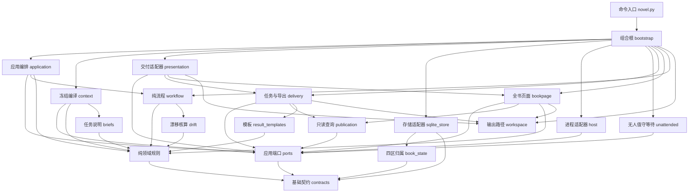

# 架构与工程目标

何时读：修改引擎、扩展命令或判断能力边界。

工程目标：百万字长篇的开书、世界模型、分卷卷纲、逐章章纲、逐章执笔自比、机械核账、历史修订、断点恢复与最终交付。协议和代码为独立实现，不与其他小说工程互通数据库或命令行为。

## 适用范围与维护依据

本页规定工程依赖、数据所有权和提交不变量。作者的创作决定保存在约定与原话中，创作判断见 [创作与自比](craft.md)；不把架构选择转换为正文写法要求。

字段与校验以源码声明和任务模板为准，接口摘要见 [协议](protocol.md)；命令及恢复步骤见 [运行](runtime.md)；测试、度量和真实长篇验收口径见 [验证](validation.md)。本文的 Mermaid 块是架构图真源，docs 为派生产物，生成及核对方法见 [图表维护](../docs/README.md)。

| 工程问题 | 读取位置 |
|---|---|
| 模块依赖、端口替换与装配 | [依赖方向](#依赖方向) |
| 主干、Worker、作者与事实的职责 | [主干循环与子 agent](#主干循环与子-agent)、[数据所有权与角色](#数据所有权与角色) |
| 修改提交、分区、缓存或恢复 | [不变量](#不变量)、[数据与失败](#数据与失败) |
| 判断已有能力与尚未支持的行为 | [当前能力边界](#当前能力边界)、[叙事与材料边界](#叙事与材料边界) |

## 判据前移与可靠底座

作者约定提供作品方向；卷纲与章纲在设计期声明资源、位置、知情、时钟、人物、情节与伏笔增量，以及本卷/本章的文风要求，引擎用卷内状态链逐章模拟；执笔后由 `drift_check` 逐项自比、`drift.reconcile` 机械核算（并产出 hook 事件），再由事实、叙事与空间的既有判据入账，同时用 `style` 的代理指标核对文风是否走样。理解记录与创作记忆仍按版本保存，实际事件才写入 canon。context 将方向、当前事实、相关理解、文风规格与原文编译为冻结任务，workflow 负责交接，SQLite 事务、不可变文档和章节分支作为可靠底座。

understanding 是 intent 内独立的版本对象，不把解释与未来方案混成事实；原文证据失效时撤下对应版本，未改后文携带后恢复其有效记录。稳定场景身份与阅读位置分离，故事时间和披露另行记录。revision_impact 给出事实重写范围与阅读影响动作；v2 没有独立阅读任务，受影响章的章纲由 `chapter_outline` 重排。协议与项目边界见 [叙事工作台](workbench.md)。

## 主干循环与子 agent

宿主主干管理作者目标、任务身份、治理命令与简短进度；子 agent（Worker）读取完整冻结材料，完成当前世界、卷纲、章纲、执笔或返修并提交。开书门任务（opening_options）例外：无正文、无派工必要性，由主干在同一会话自执（`contracts.CONTROLLER_STAGES`），选择板由引擎物化为 work/board.md。workflow 决定下一任务，主干只接收身份及状态摘要，正文与完整回执保留在项目中；无人值守的等待由 `watch` 在引擎进程内承担。主干生命周期和模型会话隔离由宿主提供，host 是可选的外部进程适配器。

compact 是派工返回视图，冻结任务、正文和材料保持完整。任务身份与执行认领分别承担提交校验和并发占用；派工、等待、同会话恢复及提交核实统一见 [主干循环](runtime.md#主干循环默认执行路径) 与 [任务交接](runtime.md#任务交接)；修订采纳、完本和交付统一按 [动作分支](runtime.md#动作分支) 执行。

## 依赖方向

箭头表示主要源码依赖，方向从调用方指向依赖。`novel.py` 只依赖基础契约与组合根，`bootstrap` 的 LocalRuntime 统一打开/初始化账本并提供视图、导出、交付与宿主执行入口。`bootstrap` 装配 SQLite、冻结编译器、文件交付、时钟与 ID 生成器；`Application` 只接收 `ports` 中声明的能力，通过注入的接口完成持久化、任务编译与交付。核心不发现项目目录、数据库文件、标准输入或宿主进程。`host` 只调用公开用例与任务状态查询。`TaskDelivery` 可选携带 `process: FileTaskTransport`，其中声明实际项目、任务和日志路径；子进程宿主在 claim 前验证该文件传输能力，非文件交付按 `host_transport` 拒绝且不会留下执行租约。

层级独立以可替换性为标准：存储、冻结编译、交付、时间和身份提供方可各自替换，核心规则与用例无需修改。`context` 依赖最小 `ContextStore`，交付与全书视图依赖只读 `PublicationReader`，完本交付也只生成文件与清单；组合根将清单交给应用的 `record_delivery` 核对当前完本快照并事务留档；查询辅助、实体注册和证据校验有独立纯模块，避免从较高层借用私有方法。模板生成由 `result_templates` 负责，机械判据由 `drift`/`lint`/`ledger` 等纯模块执行。

图中应用编排包含 `application`、`revision_service` 与 `contract_activation`。Application 保留公开用例、授权检查与事务入口；修订服务负责影响分析、分支建立、后缀重放与理解恢复，约定激活服务负责已采纳约定切换。两者在调用方事务内使用 Repository 端口；修订服务只额外接收明确的任务取消能力，不依赖 Application 或自行提交事务。

图中“纯领域规则”汇总规则模块，略去逐域边以保持可读；`drift` 单列，因为它是判据前移的主入口，同时被 workflow 直接调用。完整依赖白名单、所有作用域的导入、核心 I/O 禁令和无环约束由 `tests/test_architecture.py` 强制。替换验证须通过实际用例观察结果：内存账本跑通生命周期、只读账本生成交付、替代宿主与运行工厂执行公开入口，真实组合根另验收事务与文件效果衔接。具体回归入口按 [改动类型选择验证](validation.md#按改动类型选择验证)，完整边集由 `validation/measure.py` 测量。

架构图以 Mermaid 块形式存放在本文件（真源），快照存于 [docs/architecture.mmd](../docs/architecture.mmd) 与 README，三处逐字一致；**仓库不保存渲染件**，需要图片时从快照现场导出。图表与字段的说明各自引用对应真源，不在派生文件或其他文档中另立一套结构要求。

| 文件 | 权威职责 |
|---|---|
| contracts | 协议标识、约定字段表与按版本过滤的对齐字段、结构门档位表与档位管线形状表（PIPELINE_SHAPES）、开书枚举与共享数值默认（`DEFAULTS`，含 `world_ladder` 的位阶/阶梯条数下限与主题锚点上限）、修复上限、作者停点与通道表、错误形状；约定形状与阶段权限的唯一权威 |
| ports | 持久化、只读查询、冻结编译、交付与宿主用例的能力契约；只依赖 contracts，不持有具体资源 |
| creation | 零输入方案、逐门选择、换组回退、闭合选择与来源；只有当前门序（creation/6，13 门先定世界与格局），更早协议读取即拒；结构门的档位板由引擎按档位表即时给出；对齐字段由字段表派生 |
| world | 世界记录（支持 12 个领域，按档位要求填写）、关联、选择一致性，以及已声明的位阶、资源、格局与世界架构逐字绑定；保持设计与事实分离 |
| planning | 作者约定、卷纲与章纲的落库校验、`new_entities` 与场景形状 |
| drift | 卷纲/章纲的机械校验（含 v5 卷 `stage` 逐字取阶梯一级且只升不降）、卷内状态链模拟（`simulate`，含伏笔 `plant`/`payoff` 状态机）与执笔漂移核算（`reconcile`，产出 hook 事件）；依赖 facts/contracts/entities/narrative/spatial/ledger/world/evidence |
| style | 文风代理指标的纯核心：`metrics`（句长/段长/对白占比/本章重复度/视角标记）、`baseline`（首章锚点）与 `compare`（按契约 `style_window` 产出 style findings）；零派工，只依赖 contracts |
| narrative | 线路、节点、知情、人物当前状态与动态篇幅的纯规则 |
| entities / evidence / design_queries | 实体注册、原文证据与设计节点查询的纯共享规则，领域模块直接复用 |
| craft | 人物解释与成长签名、场景意图与展开、版本补丁合成；只依赖 contracts |
| spatial | 稳定锚点、路径与视听连接、持有链和到达下限；只依赖 contracts |
| editorial | 编辑能力字段与辅助判定（enabled/effective_contract/context_hash/scenes 等）、人物成长与声线锚点、补丁相关的纯规则；只依赖 contracts |
| facts | 原文定位、事件前值、资源、时钟、站位与历史断言的纯结算 |
| workflow | 下一任务和状态转换，内容与篇幅共享修复额度；窄返修守卫、返修复发计数与 repair-stalled 停止点；按 PIPELINE_SHAPES 安装档位流程形状（当前只有 `merge_chapter_outline`：t0/t1 把本卷卷纲与章纲合成一次派工，两个契约各自校验同一份回执） |
| briefs / result_templates | 按阶段生成任务说明与交付模板；不承担回执核验 |
| context | 面向 ContextStore 编译冻结来源、必读选择和按需资料，不依赖 workflow |
| publication | 面向 PublicationReader 的只读交付快照查询 |
| application | 公开用例、作者与运行授权、准确方案授权和单一事务入口；组合领域及专项应用服务，不解析输入文件或生成交付文件 |
| revision_service / contract_activation | 同事务内的历史修订、后缀重放、理解恢复及已采纳约定激活；依赖端口与纯规则，不反向调用应用用例 |
| sqlite_store | 持久化、唯一 pending、幂等回执、不可变材料及分支；逐章历史来源与增量目录缓存；未达文档回收 |
| presentation | 实现交付端口，组合任务目录、修复方案、世界及全书视图 |
| workspace | 输出位置与受保护资源别名判定；保护路径由存储适配器经组合根注入 |
| delivery | 任务目录物化、表单保留与回收、正文和世界导出、选择板卡片（work/board.md）、提问载荷（work/question.json）、Worker 自举卡（dispatch.md）、简报全文（brief.md）与 advance 完整视图快照（work/last-advance.json）渲染 |
| bookpage | 统一 book.html 的只读数据准备、转义与渲染；templates/ 保存 HTML 外壳及 CSS/JS，导出时全部内嵌 |
| host | 面向 HostApplication 的外部进程执行、超时终止和实际提交核实，不访问应用内部 Repository |
| unattended | 面向 WatchApplication 的无人值守等待循环：派工后由引擎进程等待外部提交并续租，仅在下一派工、作者决定、暂停、终点或 idle 时返回；本地组合根附写 work/watch.jsonl 派工日志 |
| lint | 正文机械判据（跨章逐字重复、对白引号体例、西文残留），在提交与 preflight 同套执行；只依赖 contracts |
| ledger | 可选结构化账目行的形状与四则关系验算、跨工件同键同值；只依赖 contracts |
| book_state | 项目分区的字段所有权与事务内组装；只依赖 contracts |
| story_memory | 不绑定章号的场景身份、事实/阅读关联及带来源的场景材料；旧任务按冻结身份协议；只依赖 contracts |
| revision_impact | 根据已提交章纲、事件与版本指纹保守传播事实和阅读影响；只依赖 contracts/story_memory |
| understanding | 可修订解释、原文与反证、版本选择、适用范围及随正文版本失效/恢复；只依赖 contracts |
| bootstrap | 唯一的本地组合根，将具体存储、查询、交付、时钟和 ID 提供方接到应用端口 |
| novel.py | 参数、文件/标准输入解析、访问分级与 Worker 边界；只依赖 contracts 与 bootstrap，经可替换运行工厂调用公开能力 |

## 数据所有权与角色

### 作者决定与开书结构

- 约定形状只有一处定义：contracts.CONTRACT_FIELDS（字段、类型、占位、可选性、是否参与对齐、自哪个开书版本起生效）。交付模板（result_templates.template → contracts.contract_skeleton）、结构校验（planning.validate_contract → contracts.contract_errors）和对齐核验（creation.validate_contract）全部由它派生；新增约定字段只改这张表，对齐表与字段表不一致时报 alignment_schema。对齐字段按开书版本过滤（contracts.alignment_for）：后来新增的字段不会变成旧约定没做过、却被追溯追责的决定。
- 逐门开书中，直接选择字段的唯一来源也声明在 CONTRACT_FIELDS.opening：`(门 ID, value 字段)`，主角整份选择通过字段的 shape 声明；`None` 表示该门的 value 整份投影到约定字段（来历门即 `opening: ('origin', None)` → `protagonist_origin`，shape 为 `family/arrival/cost`）。creation 从同一声明派生各门允许的输入字段和约定对齐值；世界与体量的推导输入单列在 creation.DERIVATION_INPUTS。方案提交、intake 和闭合选择的约定核验均拒绝跨门及未知字段，错误带 allowed_fields/unknown_fields。对齐值逐字段读取，禁止整份 value 合并覆盖其他门的决定。
- 开书协议只有当前版本：creation 状态声明 `novel-ledger.creation/6`（`opening/6`，13 门先定世界与格局），更早的 creation/N 在读取时被明确拒绝（以当前协议重开），方案篇幅上界是无条件的唯一规则。存储 schema 为 novel-ledger/3；已有 v3 可继续使用，v2 及更早库明确拒绝，不提供隐式迁移。
- 作者可见的方案板有两类来源：创意门的板子由主干自执（未内联时派新空历史 Worker）生成；结构门（体量与分卷）的档位板由引擎按 contracts.SCALE_TIERS 当次给出，不派工、不等待，Worker 回执按 opening_system 拒绝。引擎只给经证明写得完的档位，选择仍由作者做出，程序不替作者决定。
- 体量窗口只决定展示哪些档位；相邻档位与最大档由完整 SCALE_TIERS 决定。同一档位在不同窗口的说明与数值一致，窗口最后一项不因此成为最大档。

### 派工文件与角色

- `work/<task>/` 里两类文件分属不同作者：task.json、input.json、identity.json、dispatch.md（Worker 自举卡）、brief.md（简报全文）、chapter-*.txt 由主控生成且可重建；result.template.json（表单）与 result.json（回执）由 Worker 写。主控只在表单缺失或属于其他任务时才生成它，重跑 advance 绝不覆盖 Worker 已填内容；取消任务是唯一回收表单的事件。重派未提交任务时，引擎把上次遗留的 result.json 草稿隔离为 `result.stale.json` 并在派工卡注明——账本才是回执的记录源。
- 角色由身份而非称呼区分：read/recall 只在携带 NOVEL_TASK_ID 的派工身份下开放，主控调用按 role_boundary 拒绝；audit/export/html 是验收与交付命令，主控可用。身份本身随派工一起留档（identity.json：task_id、input_hash、阶段、worker_env），供核对与解释失败，但权限只看宿主注入的凭据——可核对的数据不是许可证，也不由 Worker 写回。

### 字面策略与材料选择

- 字面约定是项目级版本记录（book.lexical_policy），不属于约定快照；默认值在开书阶段即生效，作者改规则用 lexical 命令留档，改规则取消在途任务并作废其视图。约定里出现 lexical_policy 属于未知字段，直接拒绝。
- 字面约定的**执行范围**只声明一处：contracts.ENFORCEMENT 按阶段列出被检查的字段（terms 查禁词、names 查禁字），检查循环（planning.enforce）与交给任务的 `policy.scope` 都由它生成。因此派工说明不可能承诺程序不做的检查；新增阶段或字段只改这张表。
- 派工材料按"这一任务需要什么"投递，而不是按"这一阶段有什么"：`brief` 由 `briefs.py` 现生成（本门规则 + 本轮方法（简报里的"创意透镜"）+ 交付契约），整篇 guides 只作可选参考；必读记录只留本阶段真正要用的（v6 开书方案必读完整已选记录与拒绝记录，旧任务按冻结 required 执行）；记录哈希只在 task.json 出现一次，不复制到视图。取舍标准是"作者为这次派工付出的上下文"，不是文档是否完整。因果邻域按同一口径收窄：追踪项目只读目标与其直接前置，基础项目在固定深度与节点上限内做有界遍历，因此派工材料不随因果链长度增长，也不在长链上耗尽解释器栈。
- 改约与导入的约定激活记录 producer（主控 owner）与来源原话；promote 与 complete 的验收会复查作者决定记录，防止绕过作者边界。

## 不变量

- 所有 import（含函数内、相对与绝对包内 import）满足逐模块依赖白名单并构成无环图。纯规则不依赖应用端口、SQLite、文件、模型宿主、应用层或可变全局缓存；应用只依赖纯规则与端口。核心禁止 I/O 导入、内建 open、动态导入、eval/exec 和 Path 访问。
- **跨层共享的数值默认只有一处声明**：`contracts.DEFAULTS`（卷纲/章纲策略、`style_window` 与文风门槛、返修额度），经 `contracts.policy_default(key)` 取副本使用；契约字段默认值、`drift`/`style` 的校验、`context`/`workflow` 的兜底与测试夹具都读它，`tests/test_architecture.py::test_shared_numeric_defaults_are_declared_once` 防止重新硬编码。**分层边界仍由 `tests/architecture_table.py` 的依赖白名单管**，`DEFAULTS` 只管“同一个值只能有一个来源”，两者不是一回事。
- 任务输入与来源按哈希冻结；预检运行同一提交逻辑并回滚。同一任务已提交的相同结果幂等，不同结果拒绝。
- 领域判断、章节证据、事件结算、任务完成和状态转换全部成功才 commit；一个阶段只由一个事务入口提交。取消只更新持久状态并返回任务 ID，文件回收通过 after_commit 在提交后执行；预检与异常回滚丢弃回调。回调失败会报告交付失败，已提交的数据仍然保留。
- 章节只能在章纲存在、漂移核算通过（items 覆盖完整、`actual.from` 等于引擎投影）、字数区间、`lint`、字面规则与机械事件核验通过后入库；文风代理指标的越界项与 `lint` 命中一样按名进入有界返修。章纲本身必须先通过卷内状态链模拟（含 enter/exit 一致性、伏笔 `plant`/`payoff` 状态机与卷末闭合）。
- 作品理解不直接结算事件、替代作者约定或强制修稿；理解记录按其冻结版本读取，v2 由执笔回执提交增量（`understanding.update`），没有独立阅读任务。
- read/recall 只对携带派工身份的进程开放，主控不得代读正文；未派工的任务不生成正式材料。
- 程序核对真实宿主声明的会话身份，不证明宿主实际提供了空模型历史。
- 每章内容与篇幅消耗同一个有限预算；预检、非法字段、暂停、换 Worker、修订或改约不能增加额度。
- 未来设计、人物小传和章纲不直接产生事实。过去断言不重结算当前资源与时间。
- 候选修订保留旧正式稿；实际修改区间按重排后的章纲重写并重新过全部机械判据，窄范围修订（--through）终点外的后缀按动作先重放或原样携带并对新状态重结算（事实受影响即拒绝）。显式扩大终点时更新实际动作及传播；discard 恢复父版本及原目标。
- 历史修订由作者明确请求发起，在创建分支前分析实际影响；超界方案原子保存到 execution.revision_directive，保持原稿与章节额度，主干只获得摘要和完整方案路径。扩大执行须绑定当前 plan_hash、作者原话、准确范围及未变化的章节与创作来源；恢复和换会话不放宽边界。
- 完本必须覆盖末章、实际总篇幅区间、作者首章决定和全部关闭条件（required 节点与线路），不自动降低目标。

## 数据与失败

### 项目分区与事务快照

settings、canon、intent、execution 是同一作品事务聚合的四个持久化归属区。它们共享一个根快照、事务和版本一致性，不提供各自独立部署或独立提交的服务边界。层级解耦由能力端口和适配器替换实现；四区划分负责数据归属，两者各有职责。

documents 保存不可变完整值；chapters 引用正文、事件、章纲与核算结果，chain 连接前章及约定版本。kv.book 是 novel-ledger.book/1 根目录，仅保存 settings/canon/intent/execution 四个内容哈希；字段所有权由 book_state.PART_FIELDS 声明，未知或跨区字段拒绝。settings 保存作者约定与字面策略，canon 保存已核验投影与累计字数，intent 保存世界、卷纲、章纲及独立 understanding 作品理解，execution 保存任务推进、候选、预算与核验，以及阻断的 revision_directive 修复方案；work/revision-HASH.json 仅为其可重建副本。正文版本由 chapters/documents 独立管理。未来计划内容只归属 intent，正式提交同时更新 execution 中的运行版本与最后任务；未变分区复用原哈希。分区文档、根引用和任务提交在同一事务中更新，预检一并回滚。

领域与流程接收事务内的普通值，跨区决策可以读取完整作品视图，领域不接收 Repository 或文件路径。load 从同一根快照组装，不能逐区读取不同版本拼成混合状态；load_part 可只读一个分区。分区拆分不意味着每次领域决策已是常数成本，也不改变显式分支/完本快照保存完整交付状态的行为。tasks 保存冻结输入与回执；journal 保存操作轨迹。普通读取不隐式升级 schema。

### 历史来源与派生缓存

历史来源采用不可变逐章页：页保存正文/事件哈希、章号、摘要、章节链与前页哈希；任务冻结 history_source 的入口、截至章号和链指纹。适配器在 kv 保存每个分支的可重建目录头，首次为既有章节建页，此后只追加新章；相同历史在不同角色派工间复用，修订分支共享未改前缀。缓存头只服务派工构建，补读沿任务冻结页读取，不用当前分支查询结果替换任务来源，也不将缓存当事实真源。页与头使用现有 documents/kv，不增加表或隐式升级数据库。

历史查询默认从近到远按所需页读取事件，收齐请求的匹配章节再查一章匹配以决定分页；页数有界的常见查询不解析整本事件。稀疏/无命中查询仍可遍历全部历史，任意指定章也可能遍历目录，不宣称最坏查询复杂度不随篇幅增长。实测无命中查询在 20/100/500 章为 13.9/46.3/209.6 ms（逐页扫描，返回字符不随篇幅变化），线性但尚不构成瓶颈，因此不设默认预算：事实查询以查全优先，省时不能换成漏查。全量旧索引名称的显式读取保留，但不进入默认必读。目录优化不改变 complete_state、章节重放或携带核对的覆盖要求，也不证明整个派工流程为常数成本。

文档按内容寻址并按提交写入，因此每次提交都会留下上一版分区的不可达副本。`compact`（适配器 `prune`）从根引分、章节行、任务与日志出发做可达性遍历，只删除任何活动记录都到不了的文档并回收空间，不改写任何活动状态；它是一次显式的主控操作，不是自动后台清理。回收只解决磁盘累积，不改变单次提交仍要序列化整个分区的写入成本：同一夹具实测 140 章单次提交
27.9 ms，回收后 28.4 ms，写入成本基本由分区大小决定而非库体积。要把它降下来需要把增长集合拆成
可寻址部件、使单次提交只写变化量；那会改变根格式，须提升 book_state 版本并在打开时显式拒绝旧根，
属独立变更，当前按实测收益与风险比保留为待办而不是默认路径。

`compact` 的回收边界是**明示的**，不是"库不会长大"：它只管内容寻址的 `documents`。另有两处按任务累积、当前**不回收**：
每终结一个任务都会在 `tasks` 表留下冻结输入与完整回执（`finish_task` 只写不删，全库没有 `DELETE FROM tasks`），
`work/<task>/` 目录同样保留 task.json、input.json、result.json、identity.json 与可选日志。
量级按每章 4～6 个任务、单任务约 15 KB（表内）与约 25 KB（目录内）估算，即每章数十 KB 量级；
`usage` 报出的 `tasks` 计数就是表内累积的直接读数。之所以不自动删除：任务行是"谁在什么版本下核验了什么"的审计轨迹，
工作目录里的回执是 Worker 亲自写下的原文，回收它们会把可复盘性换成磁盘。
把它变成可回收项需要先定义保留窗口与"已提交回执可以从表内重建工作目录"的保证，
这属于独立变更（同上面的写入成本），不放在默认路径里。

### 失败与恢复边界

输入拒绝带 Error(code/message/details)，事务回滚；源哈希或重放不一致为完整性失败。视图写盘或提交后文件回收失败直接报告，数据库提交保持有效，派生文件可重建。宿主启动失败、超时、未提交和会话恢复均保留明确状态，具体处理见 [运行与恢复](runtime.md#动作分支)。

revision_blocked 表示超界方案已经原子保存，正式稿和章节额度保持。准确授权绑定数据库中的当前方案及来源，派生方案文件只作交付副本。摘要字段、文件重建和过期授权的处理见 [自动回改边界](runtime.md#自动回改边界)。

## 当前能力边界

| 工程目标 | 实现选择 |
|---|---|
| 开书与试章 | 零输入逐门选择（主干自执，13 门：脑洞门问"多了什么规则"，世界门交位阶与硬通货，格局门交升格阶梯），完成后按档位要求创建世界模型并做机械校验与位阶、资源、格局及已声明的世界架构逐字绑定；完整约定也可导入，首章定调保持 |
| 分卷与逐章设计 | 世界与约定生效后派发各卷卷纲（每卷 2000–3000 汉字，目标 2500，默认一次交全部卷；v5 项目每卷 `stage` 逐字取格局阶梯一级且只升不降；含伏笔账 `hooks` 与文风走向 `style.trend`）；进入每卷前交该卷章纲（每章约 150 汉字 + 漂移字段 + enter/exit + 伏笔 `plant`/`payoff` + 文风 `style`） |
| 事实连续性 | 章纲状态链在设计期逐章模拟资源前值与守恒、时钟、知情、位置、人物变化与伏笔埋收，卷末核对结构化终值和 clock.to（容差 0）且 required 伏笔全 paid；自然语言 exit_state 只作说明 |
| 执笔核账 | `drift_check` 逐项自比（覆盖、前态、去向、偏差理由与引文），引擎核算后按既有事实判据入账；伏笔事件由 `drift.reconcile` 产出 |
| 文学质量 | **没有独立复核**：文风由规格（卷纲 `style.trend` + 章纲 `style`）加 `style` 代理指标按契约 `style_window` 比对首章锚点，只保证**文风一致、可核对**；越界进有界返修。**不证明"好看、人物可信"**——文学判断靠作者抽读或离线评测工具（`scripts/quality_eval.py`） |
| 修改恢复 | 冻结任务、候选稿、版本化改约、历史分支、合并撤销 |
| 局部修复 | 冻结能力支持完整稿、版本补丁和原文复用；合成后重新过机械核算与 lint，不自动免检入库 |
| 作品理解 | 按人物、话题与显式引用选取版本解释、原文表达样本与反证；候选稿隔离、依据失效和恢复 |
| 场景身份 | 新协议的 ID 不绑定章号，移动仍核对唯一性与已提交来源；阅读顺序、故事时间、披露分开 |
| 修订传播 | revision_impact 沿事实读取、阅读关联与场景桥梁给出处理动作；覆盖不足或未声明变更时保守扩大范围，语义完整性无人独立核验 |
| 长篇运行 | 宿主主干调度子 agent，引擎保留主控/Worker 租约、提交核实与可选进程适配器；真实模型历史隔离另验收 |
| 存储版本 | 当前为 novel-ledger/3，四分区根目录是实际结构变化；已有 v3 可继续使用，v2 及更早库明确拒绝，不提供仅改版本号或隐式迁移 |

源码精简不证明文学质量或全程费用改善。分别衡量依赖、必读材料、派工、实际用量和返工，不以行数替代功能覆盖。

## 叙事与材料边界

新约定默认启用叙事跟踪，关闭跟踪时章纲的节点与线路可空，但资源/位置/知情/时钟/人物变化仍须核算，见 [叙事推进](narrative.md)。narrative 只依赖 contracts，facts 组合其有据结算；drift 通过 facts.apply_event 复用事实、叙事与空间状态转移，并调用世界规则做设计检查；账目验算与证据核验由流程层组合。实际进度、读者认知、当前动机均可重放，不由设计直接初始化；当前记录投影与完整可选来源分开，正文不删除、不截断。阅读关联按 reading-dependencies/1 统一解释，章纲由引擎统一冻结标记。

编辑能力冻结为 editorial/1，开关与字段见协议，专用字段见 [编辑能力](editorial.md)。craft/spatial/editorial 均是纯值规则，不传 Repository。章纲重排与正文重绑定由 workflow 返回，应用层单一事务保存；预检一并回滚。

完本快照保存完整交付状态与正文引用，delivery/bookpage 只读取冻结版本；组合根把 LocalPresentation 注入 Application，交付、页面与只读查询均不反向调用应用层。统一 book.html 和世界导出是可重建派生物，失败不回滚生效约定；生成时机和实际交付范围见 [约定与交付](world.md#约定与交付)。读取观测在适配层留痕，离线评测与宿主观察不修改故事。

承诺关联冻结为可选 hook-links/1：领域层只验证有据事件的实体/话题关联及变更理由，查询层据关联选择材料；未标注旧承诺不自动猜关系，仍能完整补读。事件解释版本随规范化事件保存，旧在途能力不被追补，旧投影不因新增字段解释而改变。派工 baseline 取任务自己的冻结 state 视图，避免在信封再灌入全量资源与承诺。read 和 recall 输出都留实际字符观测，计费仍来自宿主日志。

## 状态转移与规划范围

设计模拟、执笔核算的影子投影与正式提交共用 `facts.apply_event`。该函数只作用于调用者持有的临时投影；`facts.settle` 负责正文引文与时间表达检查，整章到期规则由 facts.check_deadlines 供模拟和正式结算共享，正式事实仍只由提交事务写入。卷纲窗口、章纲 enter/exit 和卷末闭合继续由 drift 检查。设计没有正文证据，模拟通过不能代替正文提交。路径拓扑的开放、方向、通行条件、携带关系与显式出发/抵达时间在设计期也按正式规则检查。

卷纲与章纲为必选阶段，策略解析统一由 planning.resolve_outline_policy 负责。缺省使用默认值；显式空对象、null 和不完整策略不能悄悄恢复成默认值。旧约定中的 current 按 rolling 解释；已经保存的空策略须明确改约修正。

执笔材料筛选与局部重排保持完整冻结来源；保留的后缀仍通过状态链、卷末与阅读绑定核验，细节见 [有界材料与局部重排](narrative.md#有界材料与局部重排)。

策略组合与字段形状统一见 [卷纲参数](narrative.md#参数与范围)。
