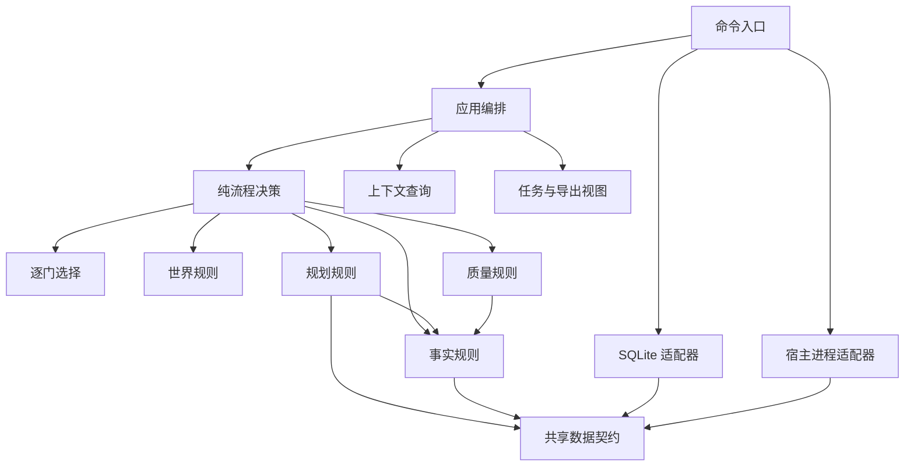

# 架构与工程目标

何时读：修改引擎、扩展命令或判断能力边界。

工程目标：百万字长篇的开书、稳定全书骨架、卷布局、近期细化、逐章独立写审、历史修订、断点恢复与最终交付。协议和代码为独立实现，不与其他小说工程互通数据库或命令行为。

## 依赖方向

箭头为主要源码依赖。Application 接收 Repository 对象，SQLite 适配器不反向 import Application；Host 接收 Application 对象执行交接。共享契约只包含协议、错误、值工具和少量类型，不持有数据库或全局故事状态。图为可读性只画主要依赖：application 逐域 import（context/creation/delivery/facts/planning/quality/workflow/world）与各域至 contracts 的边在图上省略，完整边集由 `tests/test_runtime.py` 的依赖守护和 `validation/measure.py` 的计数给出。

架构图存放于 [docs/architecture.svg](../docs/architecture.svg)；图表产物统一放 docs 目录，mermaid 源码块仍以本文档为唯一真源，契约形状以代码中的字段表为唯一真源，两者都不在文档里复制结构。

| 文件 | 权威职责 |
|---|---|
| contracts | 协议标识、约定字段表、检查点、修复上限和错误形状；约定形状的唯一权威 |
| creation | 零输入方案、逐门选择、换组回退、闭合选择与来源；对齐字段由字段表派生 |
| world | 丰富世界记录、关联及选择一致性，保持设计与事实分离 |
| planning | 作者约定、设计图、章计划和人物档案校验 |
| facts | 原文定位、事件前值、资源、时钟、站位与历史断言的纯结算 |
| quality | 首读与独立审稿回执的完整性、一致性、证据核验 |
| workflow | 下一任务和状态转换，内容与篇幅共享修复额度 |
| context | 冻结来源登记、必读选择和按需资料 |
| application | 组合领域结果、单一事务提交、作者决定和运行认领 |
| sqlite_store | 持久化、唯一 pending、幂等回执、不可变材料及分支 |
| delivery | 派生任务目录、模板和导出 |
| host | 外部进程执行、超时终止和实际提交核实 |
| novel.py | 参数、访问分级、Worker 边界与实现装配 |

## 数据所有权与角色

- 约定形状只有一处定义：contracts.CONTRACT_FIELDS（字段、类型、占位、可选性、是否参与对齐）。交付模板（quality.template → planning.skeleton）、结构校验（planning.validate_contract → contracts.contract_errors）和对齐核验（creation.validate_contract）全部由它派生；新增约定字段只改这张表，对齐表与字段表不一致时报 alignment_schema。
- `work/<task>/` 里两类文件分属不同作者：task.json、input.json、chapter-*.txt 由主控生成且可重建；result.template.json（表单）与 result.json（回执）由 Worker 写。主控只在表单缺失或属于其他任务时才生成它，重跑 advance 绝不覆盖 Worker 已填内容；取消任务是唯一回收表单的事件。
- 角色由身份而非称呼区分：read/recall 只在携带 NOVEL_TASK_ID 的派工身份下开放，主控调用按 role_boundary 拒绝；audit/export/html 是验收与交付命令，主控可用。
- 字面约定是项目级版本记录（book.lexical_policy），不属于约定快照；默认值在开书阶段即生效，作者改规则用 lexical 命令留档，改规则取消在途任务并作废其视图。约定里出现 lexical_policy 属于未知字段，直接拒绝。
- 字面约定的**执行范围**只声明一处：contracts.ENFORCEMENT 按阶段列出被检查的字段（terms 查禁词、names 查禁字），检查循环（planning.enforce）与交给任务的 `policy.scope` 都由它生成。因此派工说明不可能承诺程序不做的检查；新增阶段或字段只改这张表。
- 约定核验的独立性按 producer/reviewer 记录：改约与导入的 producer 取主控 owner，与核验者相同即拒；promote 与 complete 的验收会复查该记录。

## 不变量

- 所有 import（含函数内 import）构成无环图。纯规则不依赖 SQLite、文件、模型宿主、应用层或可变全局缓存。
- 任务输入与来源按哈希冻结；预检运行同一提交逻辑并回滚。同一任务已提交的相同结果幂等，不同结果拒绝。
- 领域判断、章节证据、事件结算、任务完成和状态转换全部成功才 commit；一个阶段只由一个事务入口提交。
- 章节只能在 facts 和 reader 都 pass、首读冻结、会话独立、篇幅与机械事件核验通过后入库。
- 首读未冻结时 CLI 默认禁止所有内容查询，任务目录不生成正式资料。宿主沙箱负责阻止 Worker 绕过 CLI 读取库或其他文件。
- 程序核对真实宿主声明的会话身份，不证明宿主实际提供了空模型历史。
- 每章内容与篇幅消耗同一个有限预算；预检、非法字段、暂停、换 Worker、修订或改约不能增加额度。
- 未来设计、人物小传和章计划不直接产生事实。过去断言不重结算当前资源与时间。
- 先块审再独立综合判断；全书、卷末和修订复核按章节链指纹绑定。
- 候选修订保留旧正式稿，完整后缀重审后才 promote；discard 恢复父版本及原目标。
- 完本必须覆盖末章、实际总篇幅区间、作者首章决定和全部关闭条件，不自动降低目标。

## 数据与失败

documents 保存不可变完整值；chapters 引用正文、事件、计划和审稿，chain 连接前章及约定版本。kv.book 保存治理状态和可由事件重放验证的事实投影。tasks 保存冻结输入、首读和回执；journal 保存操作轨迹。普通读取不隐式升级 schema。

输入拒绝带 Error(code/message/details)，事务回滚；源哈希或重放不一致为完整性失败。视图写盘失败直接报告，已入库内容可由 advance 重建视图。宿主启动失败、超时、未提交、原首读会话需恢复均显式返回。

## 当前能力边界

| 工程目标 | 实现选择 |
|---|---|
| 开书与试章 | 零输入逐门选择，完成后自动创建丰富世界并独立核验；完整约定也可导入，首章定调保持 |
| 滚动规划 | 当前卷的小窗口，稳定节点 ID 与显式因果依赖 |
| 事实连续性 | 资源前值与守恒、主支线时钟、知情、关系、承诺、地点站位和历史断言 |
| 文学质量 | 独立章审、时间文风反证、修改义务、跨章块审及综合核验 |
| 修改恢复 | 冻结任务、候选稿、版本化改约、历史分支、合并撤销 |
| 局部修复 | 编辑后交完整合成稿；不做数字补丁自动合成，不自动携带免审优化 |
| 长篇运行 | 主控和 Worker 租约、实际进程适配器；真实模型历史隔离与应用退出后的持续运行另验收 |
| 迁移 | 严格拒绝未知库；禁止直接改 schema 冒充迁移 |

源码精简不证明文学质量或全程费用改善。分别衡量依赖、必读材料、派工、实际用量和返工，不以行数替代功能覆盖。
