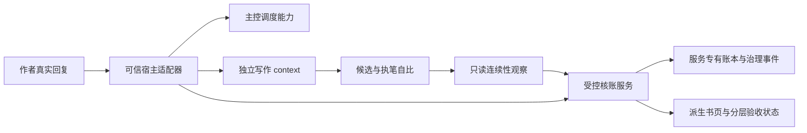

# 从自评账本走向可核对的创作流程

状态：架构提案，基于 main `54c0047` / 2.0.1 与2026-10-22冻结样本，尚未实现。范围是 novel-ledger 本项目；不创建另一个项目，不修改《深空残响》的历史正文或自动重写其章纲。

## 目标与取舍

要解决的不是“让模型多遵守几句提示”，而是四种对象被混淆：提交事务和章节通过、自报身份和宿主身份、计划声明和正文发生、机械核账和读者判断。各对象应有各自来源、状态与失败出口。

优先保留已有优势：SQLite原子提交、冻结任务、有限文学返修、正文证据、精确版本的首章认可、五章受限接续。把新的职责放到明确的边界内；不靠扩大所有任务的上下文、加更多同义禁令或再堆一套自评分表。

## 第一批：可独立交付的执行协议修复

### 1. 返回明确的业务结果

`valid/accepted/committed` 各有内部含义，但组合不足以告诉Worker“接下来改什么”。保留兼容字段一个迁移周期，新增唯一顶层 outcome，并在所有预检/提交路径统一生成诊断：

```json
{
  "outcome": "repair_required",
  "transaction": {"persisted": false, "preview": true},
  "chapter": {"number": 61, "committed": false},
  "findings": [{
    "criterion": "substance",
    "actual_han": 2964,
    "allowed": [3000, 6000],
    "repair_scope": "chapter"
  }],
  "budget": {"repairs_used": 1, "repairs_limit": 2},
  "next_action": {"actor": "worker", "action": "revise_candidate"},
  "effects_if_submitted": {"chapter_commit": false, "repair_consumption": 1}
}
```

建议业务枚举为 `design_accepted / candidate_ready / repair_required / chapter_committed / author_decision_required / blocked`。已提交回执重放仍返回原业务结果，另置 `idempotent=true`。风格报告是一个维度，不能成为总判据的替代字段。诊断引用任务材料名与准确范围，Worker不必读库或导入内部 workflow 获取原因。

`candidate_ready` 不等于已采纳；preview不能消耗文学轮次。对与已知失败候选相同、仅空白变化或在失败稿A/B之间循环的repair，返回 `no_progress`，不再次吞同一轮文学额度；相关判据确实得到修复、或提出需要独立裁决的新诊断后，再进入原有有限返修机制。候选hash只作身份标记，不能单独证明进展。不得让模型自行“重置预算”。

验收：2964汉字的61章必须明确返回不足3000；增补后需再次核全部判据。相同失败稿重复提交不额外耗轮；通过稿只有一次正式入库。所有阶段的总findings共用一个汇总器，避免CLI/API/预检各自拼凑。

### 2. 材料读取按执行世代与内容版本记账

新增服务生成的 `execution_id`，绑定 task、宿主context、actor、凭据和起止状态。交付缓存的键为 `(execution_id, material_name, content_hash)`，不能仅用task id。task读取日志保留作历史统计，不再充当当前执行者已经拥有材料的证明。

- 新空历史执行者接管同一task：新世代，首读交付全部required；保持任务、原候选和文学预算。
- 同一个实际context恢复：可以保留同世代，前提是宿主确认历史仍在。标签相同不等于历史相同。
- 五章组内：仅绑定同一个真实context的受限接续可复用未变hash；换人、换组或context清空就重建交付世代。
- 将响应区分为 `delivered / available_in_this_context / missing`；不能因前Worker看过就对新Worker返回“完整”。

短期兼容可以让换session的首读强制 `--all`，但这只是补救；长期应由上述统一交付模型处理，而非在多个CLI分支擦除task历史。

验收：A全读/部分读后换B，B都拿到全部required；同A重复读不重复交付；新B能保留原稿继续返修；快组复用不跨上下文泄漏。

### 3. 幂等确认与活任务就绪检查分开

Python worker submit 应先解析回执、绑定本次身份并路由到统一提交服务。对已完成task，只允许与持久canonical回执精确匹配的幂等确认；对pending task才执行当前准备、租约和阻断门禁。不得为了修复幂等而放宽read/check等材料入口。

验收矩阵：普通章、快组下一章已建立、整组已结束时，旧精确回执均能确认；改正文/身份/凭据重放失败；未提交的过期task仍拒绝；重试不增加章节或消耗轮次。明确返回原committed_chapter，不能引导主控prepare一个已经完成的任务。

### 4. 按失败对象和进展控制恢复

把失败归入 `execution + operation + normalized_error/fingerprint` 的恢复事件。成功read/ready只能证明读或就绪，不清除缺文件/提交/宿主工具失败。相关失败预算只在对应失败判据已修复、失败对象确实改变、缺失材料补齐或凭据由主控恢复等可验证进展后更新；完整成功提交结束本次执行。候选hash变化、改空白、无关措辞变化和重读空材料都不能单独作为进展。

技术失败上报须由宿主适配器覆盖工具失败，防止只记录进入引擎的错误。到限返回统一 blocked，watch/advance/worker-next不能一个顶层ready另一个嵌套blocked。更换随机身份不能清除治理阻断。

验收：缺文件→read→相同缺文件应达上限；改空白或A→B→A失败稿循环不清相关计数；真的创建正确候选并消除对应错误可按规则恢复；诊断失败和文学返修分别记账。采用追加事件保存失败，不把错误计数混进小说事实。

## 第二批：可信宿主与治理边界

当前同账户模型有shell和数据库写权限，环境变量及UUID都是可重造文本。不能用再加一个签名字段假装解决：如果签名私钥仍在模型可读目录，边界仍然不存在。

建议明确两种部署能力，避免虚假承诺：

| 能力 | 本地协作模式 | 受控宿主模式 |
|---|---|---|
| 身份 | 模型声明，提示核对 | 宿主登记真实 conversation/context，服务验证 |
| 写真源 | 同账户可绕过 | 仅引擎服务账户/守护进程可写，Worker无写权限 |
| 作者裁决 | 人工填写来源，真实性未证明 | 宿主签发绑定具体对象的一次性人类回复凭据 |
| 独立写作 | 协作约定，验收标未证明 | 宿主实际创建context并限制主控工具，未创建不能prepare成功 |

受控模式把引擎代码、SQLite、治理事件与签发密钥放在Worker不可写/读的权限域。Worker只拿任务级 `read/recall/check/submit/report-error`，主控只拿调度/恢复能力，作者裁决走人类通道。不能靠删环境变量变身主控；没有宿主能力时保留任务并准确报告限制。

宿主适配器应完成真实context创建、执行登记、派工投递、工具失败上报和提交确认。`prepare-worker` 接受宿主证明而非任意非空session；凭据由宿主持有或在工具通道注入。不得把主控自己的context换个名字当Worker。

拟议的受控流程如下；本地协作模式不能宣称已具备图中的权限隔离：



作者凭据至少绑定 `interaction_id + decision_id + subject_hash + option + scope + nonce`，服务持久化验证、消费并防重放。首章认可、目标授权、加轮、改约/改纲分别授权。预先授权自动加轮可以支持，但作者须显式确定问题类型和总上限，不能从“写到完本”推导。

文学轮次消费和裁决进入服务拥有的追加事件；预算是其投影，普通repository save不能覆盖治理历史。run/resume/pause/加轮/改约与执行更换均持久留痕，能从项目侧还原治理时序；本次journal漏resume正说明仅有部分动作记录不够。已有任务journal可继续复用或扩展，但只有可信服务与写权限隔离才能使追加约束有效；同账户可编辑的“只追加表”本身不能保证真实性。

任务冻结时保存引擎构建hash、执行规则hash、协议版本、材料hash与宿主context证明；由可信部署检查固定版本，升级须显式切换。版本号2.0.1不能单独证明当时源码等于当前commit，旧任务没有构建证据就保留未知，不反向补造来源。

验收必须在真实宿主而非仅Python单元夹具中执行：主控自造session失败；Worker直接开库/导入save/改引擎失败；公开submit正常；模型自写source无权加轮；真人准确凭据只成功一次。对旧项目不倒填“可信”标签，保留 `legacy_unverified`。

## 第三批：正文参与连续性核验

### 1. 明确新增职责与状态

当前流程有意不含独立章审。要获得这一能力，必须新增可见阶段及能力版本，不能把更长的self_check改名“独立审查”。建议先以只读影子方式验证，达到可接受误报后再对明确矛盾启用门禁：

`candidate_saved → continuity_observed → compared → candidate_ready/repair_required/review_required → committed`

观察者先只读候选全文、相关前态与原文，提取断言，随后才接触章纲和执笔自比。主控仍只收状态摘要；不能让它读正文代审再假称隔离。前两章全文继续保留，远距补读按候选实际涉及的实体、证物、期限、规则检索，不能只按作者主动申报的依赖检索。

每条观察附 `chapter/candidate_hash/entity_id/predicate/value/quote/start/end/confidence/epistemic_status`。区分客观死亡、看似死亡、角色误信和传闻；别名解析有歧义就待审。引文“存在”与“支持该断言”是两个检查，不能相互代替。

比较三方：已成立事实、计划契约、独立正文观察。作者自比可解释偏差，但不是唯一事实来源。未经申报的重大动作必须可见；确定的死亡→无解释活口、已抓获→首次抓捕等给矛盾对，歧义给准确证据和人工/独立复核出口。观察者不能直接给真源写事实，只有正式采纳才原子结算。

前态也要带来源与可信等级。旧账本可能来自旧执笔自评及不支持断言的引文，不能无条件当成语义真值；涉及的旧事实须回到其完整原文核对。只有已独立核验且无冲突的事实可作为确定前提，其余作为待核线索。迁移测试必须包含“旧账本记存活、原文明确击毙”，核验器应暴露前态冲突，不能为了维护旧账本而误判新正文。

不能自动重规划来使错误正文“合规”。如果原计划本身有问题，保存候选并走既有作者改纲决定；修订历史正文须给影响范围和完整方案，不能静默retcon。

### 2. 最小充分覆盖，避免把小说变成填表

动态跟踪当前情节真正依赖的对象：关键人物生命周期、在场与离场、核心证物来源/持有者、明确行动完成状态、活动期限、公开知识、正在使用的能力限制。未知要保留为未知，`not_tracked`不能伪装成`unchanged`。

本书样本：注册渡鸦及其生命周期；给芯片稳定id与来源；给当前矿井稳定id、所属外环与别名；追踪列车时限和截获任务。没有相关事件的章可零变化，不规定每章必须新增多少事实。

能力规则也需区分绝对限制、范围、例外和生效版本。本书世界同时写“永久共鸣”和72h，应先在设计阶段暴露冲突；不能一面冻结模糊规则，一面只罚执笔突破。

### 3. 时间由场景和事件约束，不由章节序号生成

保留可粗可细的时间区间，记录anchor、先后/并行/回忆/同场关系、elapsed范围。累计天数是受核对的投影；同一战斗跨多章允许day不变。

期限对象记录触发事件、到期时刻/区间、要做的事、责任人、当前状态与解决证据。场景退出时明确仍在期限内、完成、失约、延期、接管或主动放弃；不同结局都可写，但不能让新剧情覆盖未结窗口。延期必须由故事内事件支持。

设计阶段先查“连续几秒动作却连续+1日”“21:05后两小时列车，下一章却+1日”；正文再查实际时间表达。并行场景不线性累加，倒叙不倒退当前世界时间，时间不明确时不编造精确分钟。

### 4. 隔离规划注释，消除自证激励

章纲分出故事事件 `events`、执行约束 `constraints` 与读者效果 `reader_effect`。后者用于创作目的，不成为角色对白或已经发生的事实。节点/伏笔核验引用导致读者认识变化的行动、证物或对话，而非“伏笔已经兑现”的作者断言。

对非元小说中的“跨卷核心承诺”“首个主线大转折”等给语义疑点，保留上下文。不能全局禁用“第一卷”：人物讨论书稿可以合法出现。减少修饰也采用作用判断，保留能辨别对象和形成气氛的修饰；不做形容词配额。

## 第四批：独立连读与成本衡量

硬连续性和文学判断分开。五章组交接、动作终局与卷尾采用连续窗口阅读，先不看设计/自评，记录：谁的选择改变了这一场；前次胜利给下一场带来什么新约束；已经解释的事是否被重当未知；人物说的是自己的话还是任务说明；场景高低强度有无差别。

静章、心理、停顿和有意义的重复都可以成立。不能以每章必须反转/推进、对白比例、形容词频率、增加一名唱反调角色替代读者效果。保留本书工业空间、采样/机械隔离和老莫喝酒约定等长处。

成本试验在相同长度、相同材料权限、相同授权和模型设置下对照，分别记录每已采纳章的输入/缓存/输出、工具失败、返修、人工介入、首读交付量。独立观察会新增成本，必须实测是否减少严重漏检和返工；不预先声称省多少百分比。不要通过少写字、截断材料或省掉真实检查来宣布降本。

## 回归样本与上线门槛

| 测试组 | 必须命中的本次样本 | 必须放行的反例 |
|---|---|---|
| 人物生命周期 | 47/48死亡→49活口 | 明确装死、复苏机制、角色误信已纠正 |
| 行动承接 | 32已抓→33初抓；36出发→37战备；73入场→74再次入场 | 逃脱再捕、明确回返、标注补叙 |
| 时序期限 | 31当天18点→次日仍倒计时；69两小时列车→70过一天 | 正文中的延期/失约、并行时间、同场多章 |
| 地点身份 | 第七外环十二井→第四外环七井 | 明确转移目标、别名登记、不同工厂 |
| 管理语言 | 把“伏笔兑现”当事实唯一证据、人物念节点目标 | 人物讨论书稿、任务内合法的行动目标表达 |
| 来源与知情 | 芯片取出者/尸体换人；未披露身份称谓进入对白 | 可检索的移交/公开场景、叙述层“两世” |
| 表达与节奏 | 同样终局不断重开、极值修饰抹平轻重 | 类型风格性重复、有后果的新终局、有效静章 |

执行协议用确定性测试；语义观察在冻结证据集及上述正例/反例上记录召回与误报，并保留人工裁决。不存在本轮已经证明可靠的通用自然语言验证器。先影子运行，再按错误种类逐项开启阻断，避免新流程用高置信自评复制旧自证。

迁移时不改旧正文，不把旧自比自动补成独立观察；每份报告绑定准确prose/task/engine版本。质量出口分别呈现 `mechanical_integrity / process_provenance / continuity_review / literary_review` 的范围与状态。缺能力显示未验证，不能汇总成笼统“全部通过”。
